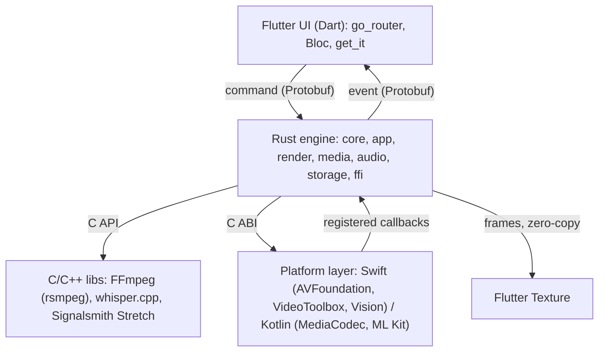

# Architecture (short)

Full reasoning: docs/plan.md (Architecture, Tech decisions, Engine details). Decisions that change this file need an ADR in docs/adr/.

## Principles
- Rust is the source of truth. Dart mirrors state from engine events and sends commands; it holds no business logic.
- Frames never cross into Dart. The engine renders with wgpu into a surface that Flutter shows through Texture.
- One Rust library (Native Assets, dynamic). Dart (dart:ffi), Kotlin (JNI), and Swift all call the same instance.
- Platform code is a thin adapter for OS media and ML APIs, registered into Rust at init.

## Engine crates (dependencies point inward)
| Crate | Owns | Must not depend on |
| --- | --- | --- |
| core | timeline, rational time, keyframes, project format, undo commands | I/O, wgpu, FFI, threads |
| app | command handling, undo stack, autosave, export orchestration, entitlement, watermark | concrete adapters (only port traits) |
| render | wgpu pipelines, shaders, compositing, texture pools | ffi |
| media | decode/encode via platform callbacks, FFmpeg fallback, demux/mux | ffi |
| audio | cpal output, mixing, resampling, time-stretch, loudness | ffi |
| storage | project files (atomic save, backups, migration), caches | ffi |
| ffi | C ABI boundary: decode command, call app, encode event | business logic |

## FFI contract
- Functions: engine_create (with protocol version), engine_send, engine_set_event_callback, engine_destroy, engine_free_*.
- engine_send only enqueues and returns; work runs on engine threads.
- Events reach Dart through NativeCallable.listener; playhead events are throttled (~30/s).
- Every exported fn uses catch_unwind and returns an error code; panics also go to Sentry.
- Protocol version mismatch: fail fast in debug, error event in release.

## Threads
| Thread | Does | Never |
| --- | --- | --- |
| Flutter UI isolate | widgets, Bloc | block on FFI |
| Engine command thread | apply commands, undo, autosave | GPU or file heavy work inline |
| Render thread | wgpu, compositing, preview on demand (0 fps idle) | allocate per frame |
| Audio callback | mix and output | allocate, lock, I/O, log |
| Decode workers / platform callbacks | hardware decode, thumbnails, waveforms | touch UI |
| Export worker | snapshot render + hardware encode | read the live project (uses an immutable snapshot) |

## Time and project file
- Time is integer/rational ticks, never float seconds.
- Project file is Protobuf with a format version and a minimum app version; atomic save (temp file + rename) and the last 2-3 saves kept.
- Field numbers are never reused; removed fields are reserved; every past format has a fixture and a migration test.

## Open risks (Phase 1 prototype)
- P1-001 wgpu output to Flutter Texture without copies (iOS IOSurface, Android SurfaceProducer).
- P1-002 hardware decoder to GPU zero-copy; Android opaque YCbCr needs a YCbCr sampler or a native convert pass.
- P1-003, P1-004 Android preview path and GLES fallback on low-end phones.
- P1-005 Rust and platform layer interop through the C ABI.
