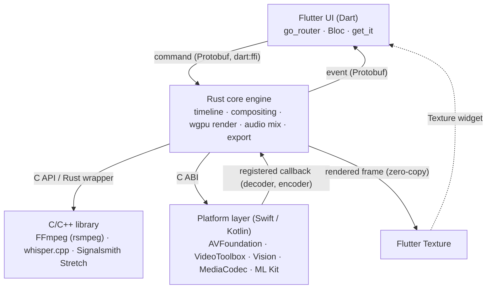
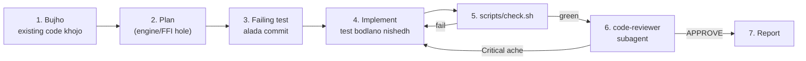
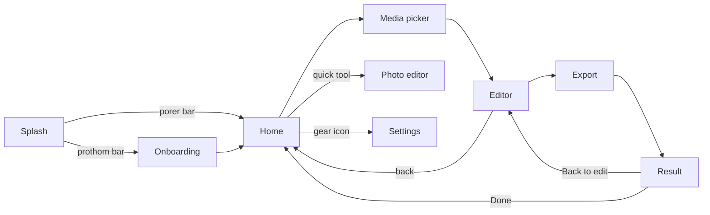
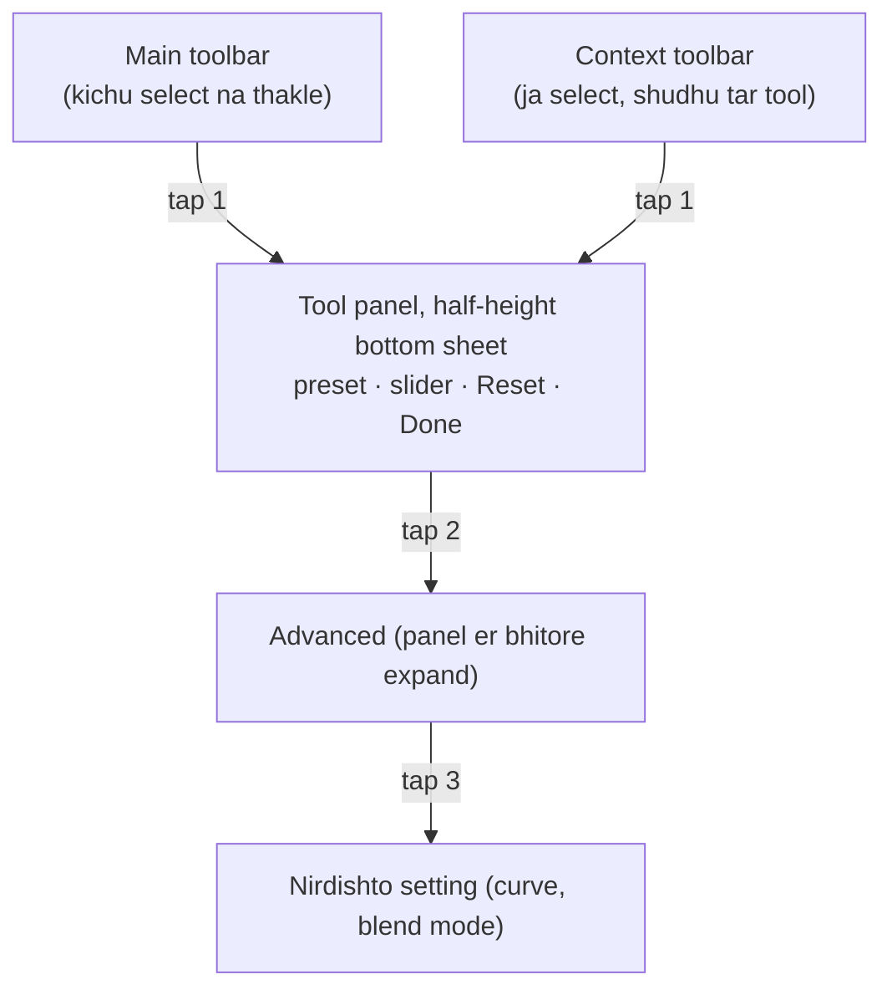

# Framix — Master Feature Checklist

Oct 11, 2026 · @Travela · updated Oct 12, 2026

Framix (Photo & Video Editor) er jonno ekta single master checklist: architecture, tech decision, tool review, toolchain, AI diye code lekha (Claude Code), v1 scope ar launch gate, 9 ta feature phase, shob screen, photo/video flow, design system, localization, UX principles, invisible system feature, engine details, resource optimization, overload handling, media format, legal, security ar reverse engineering, platform requirement, lukano gotcha, testing/release, ar backend. Protita item implement hole tick dao; CapCut audit e notun kichu pele shei phase er niche add koro.

**Ei revision e ki bodleche (Oct 12, 2026)**

- Android zero-copy (opaque YCbCr), low-end phone e GLES fallback, ar Rust ↔ platform layer interop Phase 1 risk test e jog
- Export resume v1 theke sorano (v1 e "abar shuru"), iOS 17-25 er background export path alada
- Phase 1 ke 1a/1b te bhag; screen list ar Home tab feature phase er sathe milano
- Accent duita token: fill #6E4CF5, text #A271FF (purono #7C5CFF dark surface e 4.5:1 fail korto); ColorScheme hate banano
- Toolchain: Flutter 3.47 material\_ui, AGP 9 ↔ Flutter compatibility, Xcode 27.1 er iOS 15 floor, UIScene Apple er niyom
- Glyph rendering ar Bangla ASR benchmark jog; Auto lyrics Phase 6 e
- Diagram Mermaid e; list marker ek rokom
- AI workflow: test age → code → scripts/check.sh → alada reviewer subagent; clean architecture, duplicate na, performance er niyom; sample CLAUDE.md, rule file, reviewer agent, ar Stop hook
- Notun section: v1 scope ar launch gate; Security ar reverse engineering (threat model, Pro bypass, App Check, obfuscation, signed asset manifest, supply chain)
- Jog: test media corpus, CI te GPU golden test (lavapipe), Protobuf/project format evolution niyom ar protocol handshake, kill switch ar force update, Bangla line height, naam final korar gate
- Task tracking: protita item er ID (jemon `P1-012`), status todo / in\_progress / done, `scripts/task.py` diye set hoy
- Ei file ekhon repo er docs/plan.md; AI section er sample gula repo er real file e sorano
- Review fix: Bloc state class (freezed), entitlement ar watermark Rust e, Home/Editor er 1b ar phase flag, accessibility detail, draft backup, ML runtime naam (LiteRT), CI ABI, naam conflict er notun tothyo

## Kivabe use korbe

**Status tracking:** protita checklist item er ID ache (jemon `P1-012`). Status thake `tasks/tasks.json` e: todo, in\_progress, ba done. Status bodlay shudhu `python3 scripts/task.py start|done|reopen <ID>`; script nijei ei file er checkbox ar `docs/TASKS.md` board update kore. Haate tick dio na. Command er list: `python3 scripts/task.py --help`.

Protita item er sheshe bracket e layer tag deya ache, jate bojha jay kaj ta kothay hobe:

- **\[Dart\]** Flutter UI layer
- **\[Rust\]** Rust core engine (timeline, compositing, threading, wgpu rendering, audio mix)
- **\[C++\]** C/C++ library jekhane sheta best, Rust wrapper ba C API diye
- **\[Native\]** platform layer: iOS (AVFoundation, VideoToolbox, Vision) ba Android (MediaCodec, ML Kit)
- **\[ML\]** on-device model ba AI integration
- **\[Backend\]** server side kaj; ei tag er item gula pore korbe, ekhon skip

**\[—\]** mane kono code layer na: process, test, store ba business er kaj.

Phase gula order e koro: Phase 1 ar 2 shesh holei app "kaj er" hoye jay ar architecture er shob risky ongsho test hoye jay. Kon phase e beta ar public launch, sheta niche "v1 scope ar launch er shorto" e. Legal ar auto-save item gula Phase 1 er shathei shuru korte hobe.

**Backend chhara pratham version:** jei item e \[Backend\] er sathe onno tag o ache, sheta ekhon local version e koro, server ongsho pore. Font, sticker, effect, filter, ar royalty-free music app er bhitore bundle koro; ML shudhu on-device ba platform built-in; generative AI, cloud sync, account, template sharing, ar subscription pore. Account na thakle account deletion requirement o ekhon lagbe na.

**Shuru kothay: prothom 7 kaj**

1. Naam, minimum OS, Android ABI, ar bundle ID decided (docs/adr/0001-product-basics.md: Framix, com.travela.framix, iOS 17 ar Android 10 / API 29, arm64-v8a + x86\_64); Apple ar Google developer account setup shuru koro (D-U-N-S, closed testing e shomoy lage).
2. Repo setup: folder structure (app/, engine/, native/, proto/), CLAUDE.md, .claude/rules/, .claude/agents/code-reviewer.md, scripts/check.sh, toolchain pin (FVM, rust-toolchain.toml, Gradle, NDK, Xcode), CI skeleton.
3. Vertical slice prototype: pick → decode → wgpu filter → Flutter Texture preview → trim → export, iOS ar Android dutotei. Shobcheye boro risk (zero-copy texture interop) eikhane-i confirm. Android e ekta Helio/Mali class phone ar ekta Symphony ba Walton phone e test koro (Vulkan ar GLES dui path); Android 10 minimum ar arm64-only decision (ADR 0001) ei test e confirm.
4. Timeline data model ar project file format (rational time, multi-track, keyframe, project type photo/video, minimum app version, atomic save) design.
5. Flutter skeleton: go\_router + Bloc + get\_it, navigation (Screen list onujayi), design token (colour, font), localization (English + Bangla).
6. Rust packaging (Native Assets), FFI command-event API (Protobuf), autosave, watchdog, error boundary, Sentry.
7. CI te 16 KB alignment check ar test; tarpor Phase 1 er baki feature.

## v1 scope ar launch er shorto

Proposal; nijer data ar beta feedback diye bodlao. Ei line na thakle phase barte thake, launch hoy na.

**Scope**

- Closed beta: Phase 1 (1a + 1b) ar Phase 2 shesh hole; Play er closed testing requirement o eikhane purno hoy.
- Public v1: Phase 1-3, sathe Phase 4 theke filter, adjust, transition. Baki Phase 4 ar Phase 5-9 update e.
- v1 e nijer backend nai ("Backend chhara pratham version" niyom); Sentry, analytics, remote config third-party.

**Launch gate (shob pass na hole launch na)**

- [ ] `V1-001` Crash-free user 99.5%+ (Sentry release health), beta te ontoto 2 shoptah \[—\]
- [ ] `V1-002` Android vitals: user-perceived crash ar ANR rate Play er bad-behavior threshold (crash 1.09%, ANR 0.47%) er onek niche; threshold launch er age verify \[—\]
- [ ] `V1-003` Export success 98%+ (shuru kora export er moddhe shesh holo) \[—\]
- [ ] `V1-004` Notun user er median time-to-first-export 2 minute er kom \[—\]
- [ ] `V1-005` Device matrix er low-end phone (Helio/Mali class, Symphony/Walton) e 1 minute 1080p30 project er preview smooth, export shesh, OOM nai \[—\]
- [ ] `V1-006` Cold start mid-range phone e 1.5 second er kom \[—\]
- [ ] `V1-007` Force close test e kaj harano zero (Overload handling er test) \[—\]
- [ ] `V1-008` Legal, Security, ar Platform requirement section er shob v1 item tick \[—\]
- [ ] `V1-009` English ar Bangla 100% translated, bn screenshot test pass \[—\]

**Launch er por metric**

- [ ] `V1-010` D1/D7/D30 retention, first-export rate, export completion rate, active user prati weekly export, crash-free user; ek dashboard e \[Dart\]

## Architecture



Dart theke choto command niche jay ar event upore ashe; render kora frame Rust core theke sorasori Flutter Texture e jay, Dart ke bypass kore. C/C++ library (FFmpeg, whisper.cpp, Signalsmith Stretch) jekhane best sekhane, Rust wrapper ba C API diye; ar Core ML, Vision, ML Kit platform layer (Swift/Kotlin) diye.

## Tech decisions ar karon

Core engine Rust e, Rust prefer, kintu jekhane C/C++ library best sekhane sheta (Rust wrapper ba C API diye), ar Dart-Rust connection raw dart:ffi diye; Flutter side e go\_router + Bloc + get\_it.

| Decision | Keno | Kheyal rakhte hobe |
| --- | --- | --- |
| Core engine: Rust | Memory safety (multi-thread decode/render/audio/export e crash kom), Cargo diye shohoj cross-compile, wgpu ekbar likhle Metal ar Vulkan dutoi | Media ecosystem C++ er moto mature na; shekhar curve beshi; hardware decoder er jonno platform layer lagbei |
| Rust prefer, C/C++ jekhane best | Ek language e shob logic, ek toolchain, memory safety shob jaygay. C library Rust theke call kora shohoj (bindgen), kintu C++ e cxx bridge, duita build system, ar unsafe boundary barbe | Jekhane C/C++ library lage: shudhu tar C API, chikon boundary, raw buffer pass, thread ar ownership Rust er hate |
| FFmpeg shudhu optional fallback (rsmpeg diye) | Platform demux/codec age; rare format ba software decode e FFmpeg. rsmpeg C FFmpeg er upor Rust API, tai accuracy eki | Minimal build, license check |
| Raw dart:ffi (flutter\_rust\_bridge na) | Serialization layer nai, kom dependency, full control; Dart e shudhu UI tai call kom | Binding, memory free, async callback, panic handling nije korte hobe |
| Command-event FFI API | Boundary te matro 4-5 function: engine\_create (protocol version shoho), engine\_send, engine\_set\_event\_callback, engine\_destroy | Command/event Protobuf e encode (Rust e prost, Dart e protobuf); cbindgen → ffigen |
| Frame kokhono Dart e na | Dart-Rust copy overhead eranor jonno | wgpu output Texture e zero-copy (prototype e confirm koro) |
| Engine layering: clean architecture (core → app → adapters → ffi) | Domain logic I/O ar GPU chhara test kora jay; adapter bodlale (platform decoder vs FFmpeg) core bodlay na | Dependency shudhu bhitorer dike; hot path e trait object per pixel/sample na, boundary frame/buffer level e |
| UI state: go\_router + Bloc + get\_it | Team Bloc jane; Bloc er event → state model engine er command → event er sathe mile | Bloc route er sathe BlocProvider e, get\_it shudhu long-lived service (FramixEngine) |

**FFI niyom**

- Sync FFI call UI isolate block kore, tai Rust function shudhu command niye nijer thread e pathiye shathe shathe return korbe.
- Rust theke Dart e khobor: NativeCallable.listener ba SendPort.
- Rust e allocate kora string/buffer Rust er free function diye chhere dao, na hole leak.
- Protita exported function catch\_unwind diye wrap, error code return.
- Overhead: Rust-C++ call nanosecond; asol cost data copy ar beshi bar boundary cross, tai frame zero-copy ar batch call.
- engine\_create e protocol version handshake: Dart er generated binding ar engine er proto version na mile debug e shathe shathe fail (detail: FFI ar project format evolution).
- Native Assets Rust ke dynamic library hishebe bundle kore; Kotlin (JNI) ar Swift o oi eki library call korbe, alada copy na. Rust shudhu C ABI dey, platform layer init e nijer function pointer Rust e register kore, jate eki library instance ar eki engine state.

**Boro file niyom**

- Path ba fd pathano instant; slow hoy copy (Android cache, iCloud download) ar processing.
- Pura file kokhono memory te na; streaming read ba mmap.
- Prothome shudhu metadata pore clip timeline e dekhao, thumbnail background e lazy.
- Picker Dart e (image\_picker/file\_picker), Rust picker open korbe na.

**Bloc structure**

- ProjectListBloc, EditorBloc (timeline mirror), PlaybackCubit (playhead), ToolPanelCubit, ExportBloc, SettingsCubit.
- Playhead high-frequency, tai alada Cubit + BlocSelector/buildWhen; Rust theke event throttle (second e \~30).
- Scrub seek e bloc\_concurrency restartable() ba droppable().
- State class freezed (Tool review e ekta-i beche neya); theme/bhasha persist e hydrated\_bloc.
- Undo/redo Rust e, Dart shudhu command pathay.

## Tool review

Beshirbhag tool thik ache; bodlano dorkar: Rust FFmpeg crate, text engine, time-stretch library (license), ML runtime er naam ar choice, Rust packaging, ar crash reporting. Library er obostha druto bodlay, tai use er age ekbar repo ar license dekhe nio.

| Kaj | Tool | Verdict | Karon |
| --- | --- | --- | --- |
| UI framework | Flutter | Thik | Ekbar UI likhe dui platform; Texture widget diye native preview |
| Routing | go\_router | Thik | Flutter team maintained, deep link ready |
| State | flutter\_bloc + bloc\_concurrency + hydrated\_bloc | Thik | Team jane; seek e restartable/droppable; settings persist |
| DI | get\_it | Thik | Simple service locator; shudhu long-lived service e |
| State class | freezed (Equatable er bodole ekta-i) | Choose one | freezed e sealed union state, copyWith, equality ekshathe |
| Localization | flutter\_localizations + intl + gen-l10n | Thik | Official |
| Media picker | image\_picker / file\_picker + boro video e native fd | Thik | image\_picker Android Photo Picker use kore |
| Dart ↔ Rust | dart:ffi + ffigen + cbindgen | Thik | Kom overhead, full control |
| FFI message | Protobuf (Rust e prost, Dart e protobuf) | Protobuf beche nao | Dui dike mature support; FlatBuffers er Dart support kom use hoy |
| Rust packaging | Flutter Native Assets (hook/build.dart) + native\_toolchain\_rust | Change | Native Assets ekhon stable API; native\_toolchain\_rust 1.0.x stable, Rust auto-build. Shomossha hole cargokit fallback. Rust dynamic library hishebe bundle hoy, tai Swift/Kotlin o eki library call kore (FFI niyom dekho) |
| Core engine | Rust | Thik | Memory safety, Cargo, wgpu |
| GPU render | wgpu (WGSL) | Thik, risk ache | Ekbar likhe Metal ar Vulkan; kintu IOSurface/AHardwareBuffer import e wgpu-hal er unsafe code lagbe, prototype e confirm. Android decoder er opaque YCbCr AHardwareBuffer sample korte Vulkan YCbCr sampler lage; wgpu te support na thakle native convert pass |
| Video decode/encode | AVFoundation/VideoToolbox, MediaCodec | Thik | Hardware, kom battery |
| FFmpeg Rust binding | rsmpeg (ffmpeg-next na) | Change | ffmpeg-next maintenance-only mode e; rsmpeg FFmpeg 6/7/8 track kore |
| Text shaping + layout | HarfRust + Parley (Linebender) | Change (specific) | HarfRust HarfBuzz org er official Rust port; Parley HarfRust diye rich text layout ar font fallback |
| Glyph rendering (video te text, emoji anka) | Vello ba skrifa + nijer glyph atlas (wgpu) | Add | Parley shudhu layout kore, glyph rasterize ba render kore na; COLR/CBDT color emoji o eikhane |
| Audio output | cpal | Thik | iOS ar Android dutotei |
| Resampling | rubato | Add | Pure Rust, sample rate conversion |
| Time-stretch (speed e pitch thik) | Signalsmith Stretch (MIT) | Add | Rubber Band GPL ba paid, SoundTouch LGPL; closed app e MIT nirapod |
| Loudness | ebur128 | Add | Loudness normalization er standard |
| ML runtime | iOS e Core ML, Android e LiteRT (ager naam TFLite) GPU delegate | Change | Protita platform er nijer accelerator e shobcheye druto; ekta format chaile ONNX Runtime (iOS e CoreML, Android e vendor execution provider shoho) |
| Segmentation | Apple Vision, ML Kit, MediaPipe | Thik | Built-in ba choto, free |
| Speech-to-text | whisper.cpp; iOS e Apple SpeechAnalyzer (iOS 26+) | Add | whisper.cpp MIT, on-device standard; Apple API e Bangla support ache kina check. Choto Whisper model e Bangla accuracy durbol, Phase 6 er age Bangla WER benchmark |
| Frame interpolation | RIFE er moto ML model | Add | Smooth slow-mo; license check |
| OpenCV | Shudhu dorkar hole (stabilization) | Shuru te bad | 10-30 MB size; filter/resize wgpu ar Rust crate e hoy |
| Image (Rust) | image, zune-jpeg, fast\_image\_resize, kamadak-exif | Add | Decode, resize, EXIF orientation |
| Crash reporting | Sentry | Change (specific) | Flutter, Rust panic, ar native crash ek jaygay, symbol upload; Crashlytics Rust er jonno kom shubidha |
| Analytics + remote config | Firebase Analytics + Remote Config (ba PostHog) | Thik | Backend chhara shuru kora jay |
| Subscription | RevenueCat | Thik | Receipt, entitlement, webhook ready |
| CI/CD | GitHub Actions + fastlane (ba Codemagic) | Add | Build, signing, TestFlight/Play upload automate |
| Rust testing | cargo test, insta (snapshot), proptest, cargo-fuzz, criterion | Add | Golden test, time/timeline invariant, media parser fuzz, benchmark |
| Backend (pore) | Supabase ba Firebase, Cloudflare R2 + CDN | Thik | Ready service, kom kaj |

**Language choice rule: Rust prefer, kintu best tool jitbe**

Niyom: (1) pure Rust option er output/accuracy same (eki test pass kore), speed kachakachi, active maintained, ar license thik hole Rust. (2) Na hole proven C/C++ library, Rust wrapper ba C API diye. (3) Hardware ba AI chip lagle platform API (Swift/Kotlin). FFmpeg er Rust crate (rsmpeg) pure Rust na, C FFmpeg er upor Rust API; tai accuracy FFmpeg er moto-i, ar eta-i best combination.

| Kaj | Best option | Language | Karon |
| --- | --- | --- | --- |
| GPU render, effect | wgpu | Rust | Metal ar Vulkan ekbar e; C++ e ekhane kono extra labh nai |
| Text shaping, layout | HarfRust + Parley | Rust | HarfBuzz test er beshirbhag pass, speed video text er jonno jothesto; Bangla alada kore test |
| Glyph render | Vello ba skrifa + nijer atlas | Rust | Parley er eki ecosystem (Linebender); color emoji alada test |
| Image decode, resize, EXIF | zune-jpeg, image, fast\_image\_resize, kamadak-exif | Rust | Mature, SIMD optimized; HEIC platform decoder |
| Audio decode | symphonia | Rust | AAC-LC, MP3, FLAC, WAV e bhalo; HE-AAC er moto format e platform ba FFmpeg fallback |
| Resample, loudness, mix, output | rubato, ebur128, cpal | Rust | ebur128 libebur128 er port, result eki |
| Time-stretch | Signalsmith Stretch | C++ (header-only, MIT) | Pure Rust option e quality kom |
| Video decode/encode | VideoToolbox/AVFoundation, MediaCodec | Platform | Hardware, kom battery |
| Software video fallback | FFmpeg (rsmpeg diye) | C core, Rust API | Accuracy FFmpeg er moto-i; production-ready pure Rust H.264/HEVC decoder nai |
| Demux (input file) | AVAssetReader, MediaExtractor; na parle FFmpeg | Platform + C | Shob format, battle-tested |
| Export mux | AVAssetWriter, MediaMuxer | Platform | Social app e compatible file; Rust mp4 crate kom battle-tested |
| ML heavy/realtime (segmentation, tracking) | Core ML, LiteRT | Platform | Neural Engine/NPU; pure Rust e same speed na |
| ML choto model | burn ba tract, na hole platform | Rust ba platform | Eki model, tai accuracy eki; speed jothesto hole Rust |
| Speech-to-text | whisper.cpp (whisper-rs diye) | C/C++ core, Rust API | Beshi optimized (quantization, Apple acceleration); candle whisper benchmark e same hole Rust |
| Stabilization, optical flow | Pore decide: nijer Rust + wgpu ba OpenCV module | — | Quality test kore |

Protita "Rust" decision e ekbar side-by-side test: eki input e C/C++ version er sathe output compare (pixel ba audio sample diff) ar speed benchmark. Same hole Rust, na hole C/C++.

## Toolchain ar version (latest stable)

Shob jaygay latest stable version, beta ba nightly na; version pin kora, ar niyomito update. Niche October 2026 er obostha; project shuru korar din abar check koro.

| Tool | Latest stable (Oct 2026) | Framix e ki korbe |
| --- | --- | --- |
| Flutter | 3.47.x (Dart 3.13) | FVM diye pin; Material ar Cupertino 3.47 e standalone package (material\_ui, cupertino\_ui) hishebe opt-in, purono import ekhono chole. Notun code e notun package; migration `dart fix --apply --code=migrate_design_widgets`, ar pubspec e version pin (any na) ([source](https://docs.shorebird.dev/getting-started/flutter-version/)) |
| Dart | 3.13 | Flutter er sathe ashe; latest language feature use, analyzer warning zero |
| Rust | 1.99.0 (1 Oct 2026), edition 2024 | rust-toolchain.toml e pin; protita 6 shoptaho release, patch ashle upgrade ([source](https://blog.rust-lang.org/2026/10/01/Rust-1.99.0/)) |
| Xcode / iOS SDK | Xcode 27 (iOS 27 SDK), Duo er jonno Xcode 27.1 | CI te Xcode version pin; Xcode 27 iOS 15 er niche deployment target build kore na, tai Runner ar shob pod 15+ e force (Podfile post\_install), karon kichu pod ekhono 13.0 declare kore; UIScene bodhyotamulok (iOS / App Store dekho) |
| Swift | 6.4 (Xcode 27 er sathe) | Native bridge Swift 6 language mode e (strict concurrency) ([source](https://developer.apple.com/go/?id=xcode-27_1-sdk-rn)) |
| Android | Android 17 (API 37), stable 16 Jun 2026 | compileSdk 37; Play e ekhon target 36 bodhyotamulok, target 37 test kore upgrade |
| Android Gradle Plugin | 9.4.0 (Sep 2026) | Latest na, Flutter je AGP range support kore sheta pin. AGP 9 e built-in Kotlin default (kotlin-android plugin thakle build fail), Flutter app e android.newDsl=false lagte pare; protita plugin er AGP 9 compatibility check. AGP 10 e notun Variant API bodhyotamulok. Gradle 9.6.0, JDK 17+ (JDK 21 use koro) ([Flutter AGP 9 guide](https://docs.flutter.dev/release/breaking-changes/migrate-to-agp-9)) ([source](https://developer.android.com/build/releases/agp-9-4-0-release-notes)) |
| Kotlin | 2.x latest stable (AGP built-in) | Alada kotlin-android plugin lage na |
| Android NDK | AGP default r28c (28.2); r28+ | 16 KB alignment default, NDK version explicit pin |
| C / C++ | C23, C++23 | Nijer C/C++ code nai; library (whisper.cpp, Signalsmith) er nijer standard e compile, compiler flag CI te |
| Rust crates, pub package | crates.io / pub.dev latest | Cargo.lock ar pubspec.lock commit; Renovate diye update |

**Version policy**

- [ ] `TC-001` Shob tool latest stable; boro release er 1-2 shoptaho pore prothom patch e upgrade \[—\]
- [ ] `TC-002` Exact pin: FVM (.fvmrc), rust-toolchain.toml, Gradle wrapper, NDK version, CI te Xcode version; lock file commit \[—\]
- [ ] `TC-003` Renovate ba Dependabot e protita shoptaho dependency update PR; notun version 14 din purono hole tobe (Renovate minimumReleaseAge ba Dependabot cooldown); CI pass hole merge \[—\]
- [ ] `TC-004` Protita quarter e ekdin toolchain update (Flutter, Xcode, AGP) \[—\]
- [ ] `TC-005` Security: cargo audit, dart pub outdated, GitHub advisory alert (pura plan: Security ar reverse engineering section) \[Rust\]\[Dart\]
- [ ] `TC-006` Warning zero: dart analyze, cargo clippy -D warnings, Xcode ar Gradle deprecation warning \[Rust\]\[Dart\]\[Native\]
- [ ] `TC-007` Notun OS beta (iOS June e, Android bochorer shurute) te app test, stable er age ready \[—\]
- [x] `TC-008` Minimum OS (kon purono phone e chole) ar target/compile SDK (kon notun SDK diye build) alada decision \[—\]
- [ ] `TC-009` Upgrade er age compatibility matrix: Flutter ↔ AGP ↔ Kotlin ↔ plugin, Flutter ↔ Xcode; ekta bodlale baki gula check \[—\]

## AI diye code lekha (Claude Code)

Claude Code protita session notun context e shuru kore, tai project er architecture, niyom, ar command repo er CLAUDE.md ar .claude/rules/ e likhe rakho; kaj dao choto choto, boro change e age plan, ar protita diff nije review koro ([source](https://code.claude.com/docs/en/memory)).

Protita task ekta fixed loop e chole: age failing test, tarpor code, tarpor shob check, tarpor alada context er reviewer subagent. Subagent nijer fresh context e chole, tai lekhar shomoyer dharona ar shortcut tar mathay thake na ([source](https://code.claude.com/docs/en/sub-agents)).

**Protita task er loop**



**Repo setup**

- [ ] `AI-001` Repo root e CLAUDE.md; /init diye shuru kore nije refine; 200 line er kom rakho \[—\]
- [ ] `AI-002` Folder structure: app/ (Flutter), engine/ (Rust workspace), native/ios, native/android, proto/; protita folder e choto nijer CLAUDE.md (shei folder e kaj korle load hoy) \[—\]
- [ ] `AI-003` .claude/rules/ e path-scoped rule: dart.md (app/**/\*.dart), rust.md (engine/**/\*.rs), swift.md, kotlin.md, ffi.md (proto/**, engine/src/ffi/**) \[—\]
- [ ] `AI-004` .claude/rules/ e topic rule, paths chhara (tai shob session e load): testing.md, architecture.md, performance.md (repo te file). Detail ekhane, jate CLAUDE.md 200 line er niche thake \[—\]
- [ ] `AI-005` .claude/agents/code-reviewer.md: read-only reviewer subagent (repo te file) \[—\]
- [ ] `AI-006` scripts/check.sh: ek command e shob check (cargo fmt, clippy -D warnings, cargo test, flutter analyze, flutter test, proto/ e buf lint ar buf breaking); `--quick` shudhu bodlano package, kichu na bodlale shathe shathe pass. CLAUDE.md, CI, hook, ar reviewer sobai eitai chalay, jate check er list ek jaygay thake \[—\]
- [ ] `AI-007` Optional: Stop hook diye check enforce (repo te file) \[—\]
- [ ] `AI-008` Ei master doc ke Markdown e export kore docs/plan.md; CLAUDE.md e pura doc import na, shudhu dorkari ongsho (docs/toolchain.md, docs/architecture.md), karon import o context khay \[—\]
- [ ] `AI-009` Personal setting CLAUDE.local.md e, .gitignore e \[—\]
- [ ] `AI-010` Je niyom kokhono bhanga jabe na (secret file, signing key, main branch e push) settings er permissions.deny ba hook diye enforce; CLAUDE.md shudhu guide, guarantee na \[—\]
- [ ] `AI-011` Barbar kora kaj (notun tool panel, notun FFI command, notun effect shader) skill hishebe \[—\]
- [ ] `AI-012` /context diye dekho kon CLAUDE.md ar rule load hoyeche; /memory diye edit; path-scoped rule load na hole frontmatter format check \[—\]

**Repo er file (source of truth)**

Sample gula ekhon repo te real file; ekhane copy rakha hoy na, jate duita version alada hoye na jay.

| File | Ki |
| --- | --- |
| CLAUDE.md | Layout, command, rule, workflow, task tracking; docs/architecture.md ar docs/toolchain.md import |
| .claude/rules/testing.md, architecture.md, performance.md | Topic rule, shob session e load |
| .claude/rules/dart.md, rust.md, ffi.md, swift.md, kotlin.md | Path-scoped rule (oi file e kaj korle load) |
| .claude/agents/code-reviewer.md | Read-only reviewer subagent |
| .claude/settings.json | Secret file deny, tracker file haate edit deny, main e push deny, Stop hook |
| scripts/check.sh | Shob check ek command e (`--quick` shudhu bodlano jinish) |
| scripts/stop-check.sh | Stop hook script |
| scripts/task.py | Task tracker (status set, board, next, check) |
| tasks/tasks.json | Shob task er status (script chhara edit na) |
| docs/TASKS.md | Generated board: kon section e koto todo, in\_progress, done |

**Task tracking**

- Status tin ta: todo, in\_progress, done. Kaj shuru e `task.py start <ID>`, shesh e (check green ar reviewer APPROVE er por) `task.py done <ID> --commit <sha>`.
- Kaj korte giye notun kaj (bug, missing ongsho) pele `task.py add <PREFIX> "<title>"`; chalu task chupchap baray na.
- Atke gele status in\_progress thake, `task.py note <ID> "blocked: ..."`, ar tomake janay.
- Owner human (process, store, legal er moto \[—\] item) task Claude start ba done kore na; shudhu note dite pare. Tumi nijei `--as-human` diye bodlao.
- Ek branch e ek shomoy ekta in\_progress task.
- `scripts/check.sh` protibar `task.py check` chalay: plan.md ar tasks.json er ID mile kina.

**Kaj korar niyom**

- Ekbare ekta choto task (doc er ekta checklist item, ID diye); "pura app banao" ba "pura editor banao" na
- Kaj er age existing code khoja: eki ba kachakachi kaj already thakle reuse ba extend, notun copy na
- Requirement spashto na hole Claude age prosno korbe; je dharona niyeche sheta report e likhbe
- engine/, FFI, threading, ba project file format e change er age plan mode e plan, review kore tarpor code
- Test age: failing test likhe chalano, failing assertion dekhano, test alada commit; implementation e oi test bodlano nishedh. Test tumi nije review koro, karon test-i spec
- Implement er por scripts/check.sh green ar notun warning zero; na hole kaj shesh na
- Tarpor code-reviewer subagent: shob Critical fix, abar check; fix choto na hole abar review
- Hot path e change hole benchmark age ar pore, dutor number report e
- Shesh e report: ki bodleche, check result, reviewer verdict, baki Warning, dharona
- Version: Claude er jana version purono hote pare; docs/toolchain.md er version mene chola ar API niye shondeho hole official doc check korte bolo
- Reviewer agent er porer o diff nije review: bishesh kore unsafe Rust, FFI, memory, thread, ar audio/render loop
- Choto commit, spashto message; boro feature branch e, PR review kore merge
- Secret (API key, keystore, certificate) kokhono repo te ba Claude er chat e na
- Claude same vul dui bar korle, ba reviewer barbar eki issue pele, sheta rule file e jog koro
- Architecture ba decision bodlale age ei master doc, docs/plan.md, ar docs/adr/ update, tarpor code

**Task prompt template**

```text
Task: <ID> <doc er checklist item>
Context: @docs/architecture.md, <related file>
Constraints: <jemon: no new dependency, Rust only, no Dart logic>
Hot path: <ha/na; ha hole benchmark age ar pore>
Done mane: failing test age (alada commit), scripts/check.sh green, notun warning nai, code-reviewer APPROVE (Critical 0), docs update, task.py done <ID>
```

## CapCut-style app er main challenge

Flutter diye UI ongsho druto hoy, kintu kajer 70-80% asole native media engineering. Niche je challenge gula alochona hoyeche:

| Challenge | Keno kothin | Shomadhan |
| --- | --- | --- |
| Real-time preview | Scrub korar shomoy filter, text, sticker shoho 30/60 fps e frame dekhate hoy | Hardware decode, GPU shader (wgpu), Texture widget |
| Multi-track composition | Video, audio, text, sticker layer er alada timing, speed, opacity mile ekta frame | Rust core e compositing engine, shurutei multi-track data model |
| Audio-video sync | Ektu pichiye gele lip sync noshto | Audio clock master, VFR video shothik handle |
| Export / encoding | CPU/GPU heavy, lomba shomoy, OS background e app kill korte pare | Hardware encoder, progress/cancel, background export |
| FFmpeg | ffmpeg\_kit\_flutter 2025 e retire; LGPL/GPL ar codec patent | Platform API age; FFmpeg optional fallback, nijer minimal build + rsmpeg |
| Memory ar performance | 4K er ekta raw frame 30+ MB; kom dami Android e crash | Streaming read/mmap, frame cache limit, lazy thumbnail, proxy |
| Platform difference | iOS ar Android er media API puropuri alada, Android e hajar device | Common Rust core + patla platform layer |
| AI features | Model size, real-time speed, integration | Built-in ML (Vision, ML Kit), quantize, on-demand download |
| Boro file import | Android content:// URI copy ar iCloud download slow | Fd pass kora (copy chhara), loading state, metadata age |

## App size estimate

Shob kichu bundle korle approximate 100-250 MB+ hobe; optimize kore initial download 40-70 MB e rakha possible, baki feature use korar shomoy download hobe. Hishab Android arm64 er jonno, approximate.

| Part | Size (MB) | Kivabe komano jay |
| --- | --- | --- |
| Flutter engine + Dart code | 8–15 | Flutter nije choto ongsho |
| Native media engine (Rust/C++) | 5–20 | Rust + C++ std library mile 1–5 MB extra; opt-level z, LTO, strip |
| FFmpeg | 10–60 | Minimal build (H.264/H.265/AAC) e 10–15; platform API use korle prai 0 |
| ML runtime (LiteRT / ONNX / MediaPipe) | 3–20 | Built-in ML (Apple Vision, ML Kit) |
| Segmentation model | 1–10 | int8 quantize (\~4x choto) |
| Face/body tracking model | 3–15 | On-demand download |
| Speech-to-text (Whisper) | 40–150 | Shobcheye boro; prothom use e download, ba iOS Speech framework |
| Filter LUT, font, sticker, effect | 10–50+ | Server theke on-demand |

Spreadsheet version: capcut\_flutter\_app\_size.xlsx (editable number, auto total).

## Phase 1: Core editing

Ei phase e engine er mul pipeline dandabe: pick → decode → render → preview → trim → export. Shuru te ekta vertical slice prototype banao, tarpor baki gula.

**Phase 1a ar 1b:** 1a holo prothom milestone: risk test, import, basic timeline, transform, export, reliability. "1b" mark kora item gula 1a shesh hole; screen er moddhe Learn tab, Tool search, Recently deleted, ar interactive tutorial o 1b.

**Architecture risk test (prototype)**

- [ ] `P1-001` wgpu output ke copy chhara Flutter Texture e dekhano (iOS IOSurface/CVPixelBuffer, Android HardwareBuffer) \[Rust\]\[Native\]
- [ ] `P1-002` Hardware decoder theke GPU te zero-copy frame. Android e MediaCodec output prai opaque YCbCr AHardwareBuffer, Vulkan e YCbCr sampler lage; wgpu te support na thakle Plan B: native pass (Vulkan YCbCr sampler ba GLES samplerExternalOES) diye RGBA te convert, tarpor wgpu te import (ek GPU copy, CPU copy na) \[Native\]\[Rust\]
- [ ] `P1-003` Android preview output: SurfaceProducer er Surface theke ANativeWindow baniye sorasori wgpu surface e render; AHardwareBuffer path er sathe tulona \[Native\]\[Rust\]
- [ ] `P1-004` Low-end Android e GLES fallback: Texture output ar decoder import dui backend e kaj kore kina (GLES 3.0 e compute shader nai) \[Rust\]\[Native\]
- [ ] `P1-005` Rust ↔ platform layer interop: C ABI + init e callback register (FFI niyom dekho) \[Rust\]\[Native\]
- [x] `P1-006` dart:ffi command-event API (engine\_create with protocol version, engine\_send, engine\_set\_event\_callback, engine\_destroy) \[Dart\]\[Rust\]
- [x] `P1-007` cbindgen → ffigen binding pipeline \[Rust\]\[Dart\]
- [x] `P1-008` Panic handling (catch\_unwind) ar memory free function \[Rust\]

**Project ar import**

- [ ] `P1-009` Notun project, project save/load \[Rust\]
- [ ] `P1-010` Aspect ratio select (9:16, 16:9, 1:1, 4:5, 3:4, 21:9) \[Dart\]\[Rust\]
- [ ] `P1-011` Video/image import (gallery ar Files/iCloud Drive/Google Drive er moto cloud storage), multi-select order shoho, color/blank clip \[Dart\]
- [ ] `P1-012` Android e boro file er jonno file descriptor (fd), copy chhara \[Native\]
- [ ] `P1-013` Metadata read (duration, resolution, codec, rotation) \[Rust\]
- [x] `P1-014` Timeline data model multi-track ar keyframe mathay rekhe design \[Rust\]
- [ ] `P1-015` **1b:** Project folder, search, sort (date, naam, size) \[Dart\]\[Rust\]
- [ ] `P1-016` **1b:** Recently deleted (30 din), vul kore delete hole ferot ana \[Rust\]\[Dart\]
- [ ] `P1-017` **1b:** Protita project koto storage nicche dekhano, proxy/cache clean option \[Rust\]\[Dart\]

**Timeline basics**

- [ ] `P1-018` Trim, split, merge, delete, duplicate \[Rust\]\[Dart\]
- [ ] `P1-019` Drag kore reorder \[Dart\]
- [ ] `P1-020` Timeline zoom in/out, scrubbing preview \[Dart\]\[Rust\]
- [ ] `P1-021` Lazy thumbnail strip generation (background thread) \[Rust\]
- [ ] `P1-022` Snapping ar haptic feedback \[Dart\]
- [x] `P1-023` Undo/redo (command pattern) \[Rust\]
- [ ] `P1-024` **1b:** Multi-select clip (ekshathe move, delete, copy) \[Dart\]\[Rust\]
- [ ] `P1-025` **1b:** Frame-by-frame nudge (ek frame shamne/pichhe), precise trim \[Dart\]\[Rust\]
- [ ] `P1-026` **1b:** Track mute, hide, lock \[Rust\]\[Dart\]
- [ ] `P1-027` **1b:** Selection loop playback (ekta ongsho bar bar chalano) \[Rust\]
- [ ] `P1-028` **1b:** Photo clip er default duration ar shob photo te ekshathe duration set \[Rust\]

**Clip transform**

- [ ] `P1-029` Crop, rotate, mirror/flip \[Rust\]
- [ ] `P1-030` Canvas e position, scale (pinch/drag handle) \[Dart\]\[Rust\]
- [ ] `P1-031` Replace clip \[Rust\]

**Export**

- [ ] `P1-032` Resolution (720p, 1080p, 2K, 4K), frame rate (24/30/60), bitrate \[Rust\]\[Native\]
- [ ] `P1-033` Estimated file size dekhano \[Rust\]
- [ ] `P1-034` Hardware encoder (VideoToolbox, MediaCodec) \[Native\]
- [ ] `P1-035` Progress, cancel, fail handling \[Rust\]\[Dart\]
- [ ] `P1-036` Save to gallery, share sheet \[Dart\]
- [ ] `P1-037` **1b:** Platform export preset (TikTok/Reels/Shorts 9:16 1080p, YouTube 16:9, Instagram 4:5) \[Dart\]\[Rust\]

**Reliability (Phase 1 ei lagbe)**

- [ ] `P1-038` Auto save ar crash recovery \[Rust\]
- [ ] `P1-039` Proxy media (4K preview er jonno kom resolution copy) \[Rust\]
- [ ] `P1-040` Overload handling er mul ongsho: protita command er por autosave, engine watchdog, Flutter error boundary, export pre-flight check (detail: Overload handling section) \[Rust\]\[Dart\]
- [ ] `P1-041` Sentry setup ar render on demand (detail: Sentry setup, Resource optimization) \[Dart\]\[Rust\]
- [x] `P1-042` engine_free_buffer ke unsafe extern "C" fn koro (# Safety doc); safe Rust theke arbitrary EngineBuffer free kora UB. guard.rs test e unsafe block lagbe, tai user er approval chai \[Rust\]
- [x] `P1-043` Clip/track id undo er por reuse hoy: snapshot next_id o ferot ane; id counter snapshot er baire rakho (shudhu bare) \[Rust\]
- [ ] `P1-044` engine_destroy non-blocking: detach + end-of-stream marker (non-null); Dart closes the listener on the marker and frees in-flight events. Needed before autosave I/O runs on the command thread \[Rust\] \[Dart\]

## Phase 2: Audio

Audio clock ke master dhore A/V sync rakho; audio engine er choice (cpal, ba Android e oboe ar iOS e AVAudioEngine) ei phase er shurutei final koro.

- [ ] `P2-001` Audio engine ar A/V sync clock \[Rust\]\[Native\]
- [ ] `P2-002` Background music add, multi audio track \[Rust\]
- [ ] `P2-003` Original audio mute ar volume \[Rust\]
- [ ] `P2-004` Extract audio from video \[Rust\]
- [ ] `P2-005` Audio trim, split, speed \[Rust\]
- [ ] `P2-006` Volume keyframe, fade in/out \[Rust\]
- [ ] `P2-007` Waveform dekhano timeline e \[Rust\]\[Dart\]
- [ ] `P2-008` Voiceover recording (countdown, live waveform) \[Native\]\[Dart\]
- [ ] `P2-009` Sound effects library \[Dart\]\[Backend\]
- [ ] `P2-010` Music library (category, search, preview, download) \[Dart\]\[Backend\]
- [ ] `P2-011` Device theke music import \[Dart\]
- [ ] `P2-012` Beat detection: auto ar manual marker \[Rust\]
- [ ] `P2-013` Auto ducking (voice thakle music automatically kome jay) \[Rust\]
- [ ] `P2-014` Voice effect/changer, pitch \[Rust\]
- [ ] `P2-015` Noise reduction \[Rust\]\[ML\]
- [ ] `P2-016` Enhance voice (clarity) \[ML\]
- [ ] `P2-017` Vocal isolation (voice ar music alada) \[ML\]
- [ ] `P2-018` Audio EQ \[Rust\]
- [ ] `P2-019` Loudness normalization (shob clip er volume shoman) \[Rust\]
- [ ] `P2-020` Video theke audio detach/unlink (J-cut, L-cut) \[Rust\]
- [ ] `P2-021` Duita audio clip er majhe crossfade \[Rust\]
- [ ] `P2-022` Audio level meter (preview e volume koto) \[Rust\]\[Dart\]

## Phase 3: Text, sticker, overlay

Picture-in-Picture ei phase e multi-track compositing engine ke shobcheye beshi test korbe.

**Text**

- [ ] `P3-001` Text add, font, color, stroke, shadow, background, opacity, spacing, alignment \[Dart\]\[Rust\]
- [ ] `P3-002` Text rendering engine: HarfRust (shaping) + Parley (layout, font fallback), Bangla shoho complex script \[Rust\]
- [ ] `P3-003` Glyph rendering: Parley er glyph ke wgpu te anka (Vello ba skrifa + glyph atlas), color emoji shoho \[Rust\]
- [ ] `P3-004` Local font import, online font on-demand download \[Dart\]\[Backend\]
- [ ] `P3-005` Text animation (in/out/loop) \[Rust\]
- [ ] `P3-006` Text template ar caption template \[Rust\]\[Backend\]
- [ ] `P3-007` Karaoke style caption (word by word highlight) \[Rust\]

**Sticker ar overlay**

- [ ] `P3-008` Sticker, emoji, animated GIF sticker, search \[Dart\]\[Rust\]
- [ ] `P3-009` Photo cutout theke custom sticker \[ML\]\[Rust\]
- [ ] `P3-010` Picture-in-Picture (video/image overlay), multi-layer timeline \[Rust\]
- [ ] `P3-011` Blend mode (multiply, screen, overlay, ityadi) \[Rust\]
- [ ] `P3-012` Opacity \[Rust\]
- [ ] `P3-013` Split screen / layout (2-4 ta video ek screen e) \[Rust\]
- [ ] `P3-014` Snap/alignment guide (text, sticker majhkhane ba onnor sathe line e anle snap) \[Dart\]\[Rust\]
- [ ] `P3-015` Preview e grid ar social safe zone overlay (TikTok/Reels er button kothay dhakbe) \[Dart\]

## Phase 4: Visual effects ar color

Shob effect GPU shader (WGSL, wgpu) e chalbe; ekta common effect/shader system banale protita notun effect jog kora druto hobe.

- [ ] `P4-001` Effect/shader plugin system \[Rust\]
- [ ] `P4-002` Filter (LUT based), category, intensity slider \[Rust\]\[Dart\]
- [ ] `P4-003` Adjust: brightness, contrast, saturation, exposure, temperature, tint, highlight, shadow, sharpen, vignette, grain \[Rust\]
- [ ] `P4-004` HSL (protita rong alada), curves, color wheel \[Rust\]
- [ ] `P4-005` Color match (ek clip er look arek clip e) \[Rust\]\[ML\]
- [ ] `P4-006` Transition (fade, slide, zoom, glitch, ityadi), duration, apply to all \[Rust\]
- [ ] `P4-007` Video effect (glitch, blur, shake, light leak, ityadi) \[Rust\]
- [ ] `P4-008` Body effect \[Rust\]\[ML\]
- [ ] `P4-009` Mask (linear, mirror, circle, rectangle, heart, star), feather, invert \[Rust\]
- [ ] `P4-010` Background: color, blur, image, canvas style \[Rust\]
- [ ] `P4-011` Favorite effects/filter save \[Dart\]
- [ ] `P4-012` User er nijer LUT (.cube file) import \[Rust\]\[Dart\]

## Phase 5: Advanced editing

Keyframe system ta generic hote hobe, jate position, scale, rotation, opacity, filter intensity, volume shob kichu ekoi system e animate kora jay.

**Keyframe ar animation**

- [ ] `P5-001` Generic keyframe system (shob setting e) \[Rust\]
- [ ] `P5-002` Easing ar graph editor (custom curve) \[Rust\]\[Dart\]
- [ ] `P5-003` Clip animation: in, out, combo, zoom in/out \[Rust\]

**Speed**

- [ ] `P5-004` Normal speed 0.1x–100x \[Rust\]
- [ ] `P5-005` Speed curve (preset ar custom ramp) \[Rust\]
- [ ] `P5-006` Auto Velocity (beat onujayi speed ramp) \[Rust\]
- [ ] `P5-007` Smooth slow-motion (optical flow frame interpolation) \[Rust\]\[ML\]
- [ ] `P5-008` Reverse \[Rust\]
- [ ] `P5-009` Freeze frame \[Rust\]

**Onnanno**

- [ ] `P5-010` Chroma key (green screen) \[Rust\]
- [ ] `P5-011` Stabilization \[Rust\]
- [ ] `P5-012` Main track / magnetic timeline toggle \[Rust\]
- [ ] `P5-013` Copy/paste attributes, apply to all \[Rust\]
- [ ] `P5-014` Batch edit (onek clip e ekshathe) \[Rust\]
- [ ] `P5-015` Video quality: noise reduction, flicker remove \[Rust\]\[ML\]
- [ ] `P5-016` Photo clip e Ken Burns (dhire zoom/pan) auto motion \[Rust\]
- [ ] `P5-017` Timeline e user marker (note shoho) \[Rust\]\[Dart\]
- [ ] `P5-018` Compound clip / group (kayekta clip ke ek clip hishebe) \[Rust\]
- [ ] `P5-019` Ek project theke arek project e clip copy/paste \[Rust\]

## Phase 6: AI features

Jekhane possible platform er built-in ML (Apple Vision/Speech, Google ML Kit) use koro; heavy model on-demand download ar int8 quantize koro. Generative feature (image/video generation) server e chalbe.

**On-device AI**

- [ ] `P6-001` ML runtime integration: iOS e Core ML, Android e LiteRT (ager TFLite) GPU delegate, MediaPipe (detail: Tool review) \[Native\]\[ML\]
- [ ] `P6-002` Model on-demand download ar version management; load er age signed manifest e hash verify (Security dekho) \[Rust\]\[Backend\]
- [ ] `P6-003` Auto caption (speech recognition), language select, caption edit list \[ML\]\[Dart\]
- [ ] `P6-004` Bangla ASR benchmark: Bangla test set (bhinno accent, noise) e Whisper size gula ar Bangla fine-tuned model er WER ar license; caption feature final korar age \[ML\]
- [ ] `P6-005` Auto lyrics (gaan theke lyrics): gaan e speech recognition durbol, ar copyrighted lyrics er legal prosno; Phase 2 theke ekhane sorano, legal check er por \[ML\]\[—\]
- [ ] `P6-006` Remove filler words, invalid clip label \[ML\]
- [ ] `P6-007` Text-to-speech \[ML\]\[Native\]
- [ ] `P6-008` Custom voice (voice clone) \[ML\]\[Backend\]
- [ ] `P6-009` Background removal, video: person e on-device (Apple Vision person segmentation, MediaPipe/ML Kit selfie); edge refine, temporal smoothing (flicker kom), export er age background e mask precompute; HD/pro quality pore server e \[ML\]
- [ ] `P6-010` Motion tracking (text/sticker ke object er sathe) \[ML\]\[Rust\]
- [ ] `P6-011` Auto reframe (16:9 → 9:16 smart crop) \[ML\]
- [ ] `P6-012` Retouch/beauty (smoothing, reshape) \[ML\]\[Rust\]
- [ ] `P6-013` Enhance/upscale video \[ML\]
- [ ] `P6-014` AI style effect (anime, cartoon, painting style) \[ML\]\[Backend\]

**Background removal details**

On-device model manush (selfie, portrait) e bhalo, free, offline, ar private; durbol jayga: chul/lomer sukkho edge, transparent jinish (kach, dhoa), subject ar background er rong kachakachi, onek manush ba jotil scene, video te edge flicker, ar kom dami phone e video te lag.

- [ ] `P6-015` Preview e kom resolution mask; export er age full quality mask background e baniye cache \[Rust\]\[ML\]
- [ ] `P6-016` Edge refine (mul chhobir rong dekhe mask upscale) ar temporal smoothing (ager-porer frame mile, flicker kom) \[Rust\]
- [ ] `P6-017` Manual brush refine (add/erase), photo ar video dutotei \[Dart\]\[Rust\]
- [ ] `P6-018` Boro on-device model test (MODNet, U²-Net, BiRefNet): quality vs app size ar speed \[ML\]
- [ ] `P6-019` Model license check; kichu model (jemon BRIA RMBG) commercial use e free na \[—\]
- [ ] `P6-020` HD remove (chul, transparent jinish, product photo) server e, Pro feature hishebe, pore \[Backend\]

**AI editing**

- [ ] `P6-021` Auto Cut (beat, speech pause, ba text prompt onujayi auto trim ar sync) \[ML\]\[Rust\]
- [ ] `P6-022` Long video to shorts \[ML\]\[Backend\]
- [ ] `P6-023` Script to video / text to video \[Backend\]
- [ ] `P6-024` AI translation ar dubbing \[Backend\]

**Generative AI (server)**

- [ ] `P6-025` AI image generation (text prompt theke) \[Backend\]
- [ ] `P6-026` AI video generation (text ba image theke), multiple model support \[Backend\]
- [ ] `P6-027` AI avatar / digital human, lip sync \[Backend\]

## Phase 7: Photo editor

Video engine er filter, adjust, text, sticker, mask mostly reuse hobe, karon image mane ekta single frame.

**Basic**

- [ ] `P7-001` Layer system: list, reorder, hide, lock \[Rust\]\[Dart\]
- [ ] `P7-002` Crop, rotate, resize image \[Rust\]
- [ ] `P7-003` Filter, adjust, HSL, curves (video engine theke reuse), one-tap preset ar photo template \[Rust\]
- [ ] `P7-004` Text, sticker (reuse) \[Rust\]
- [ ] `P7-005` Frame, border \[Rust\]
- [ ] `P7-006` Collage, image merge \[Rust\]
- [ ] `P7-007` Color match \[Rust\]\[ML\]
- [ ] `P7-008` Meme generator \[Rust\]\[Dart\]
- [ ] `P7-009` Save: JPG/PNG/WebP, quality select \[Rust\]
- [ ] `P7-010` Background remove kora chhobi transparent PNG hishebe save \[Rust\]
- [ ] `P7-011` Ek chhobi theke onek size e export (story, post, cover) \[Rust\]

**AI photo tool**

- [ ] `P7-012` Background remove, photo: on-device (iOS 17+ Vision subject lift, Android ML Kit Subject Segmentation); chul/transparent jinish e HD option pore server e \[ML\]
- [ ] `P7-013` Retouch (face smoothing, reshape) \[ML\]
- [ ] `P7-014` Object remover / eraser \[ML\]\[Backend\]
- [ ] `P7-015` AI text remover (chhobir lekha muche dewa) \[ML\]\[Backend\]
- [ ] `P7-016` AI enhance, upscale \[ML\]
- [ ] `P7-017` Old photo restoration \[ML\]\[Backend\]
- [ ] `P7-018` Low-light enhancer \[ML\]
- [ ] `P7-019` AI expand (chhobi baire extend) \[Backend\]
- [ ] `P7-020` Relight \[ML\]\[Backend\]
- [ ] `P7-021` Product photo (background change, shadow, studio look) \[ML\]\[Backend\]

**Design Studio (shesh dike)**

- [ ] `P7-022` Poster, banner, social visual template \[Rust\]\[Backend\]

## Phase 8: Capture, templates, ecosystem

**Capture ar create**

- [ ] `P8-001` In-app camera (filter, beauty shoho) \[Native\]\[Rust\]
- [ ] `P8-002` Teleprompter \[Dart\]\[Native\]
- [ ] `P8-003` Slideshow / photo to video (auto music + transition) \[Rust\]
- [ ] `P8-004` Cover (thumbnail) editor \[Rust\]\[Dart\]

**Templates**

- [ ] `P8-005` Template format design (replaceable media slot, text slot); shudhu data (parameter, LUT, image), kono code ba shader na \[Rust\]
- [ ] `P8-006` Template feed (vertical preview), category \[Dart\]\[Backend\]
- [ ] `P8-007` Template use flow: media pick → auto-fill → text replace → export \[Dart\]\[Rust\]
- [ ] `P8-008` User template create ar share; onner template import untrusted file er niyom e (Security dekho) \[Rust\]\[Backend\]
- [ ] `P8-009` Trending style \[Backend\]

**Asset ecosystem**

- [ ] `P8-010` Effect, sticker, font, music online library, on-demand download \[Backend\]\[Dart\]
- [ ] `P8-011` Downloaded asset manage (delete kore storage free) \[Dart\]
- [ ] `P8-012` In-app search (effect, sticker, music) \[Dart\]\[Backend\]
- [ ] `P8-013` Stock media library \[Backend\]

## Phase 9: Cloud, platform, monetization

**Account ar cloud**

- [ ] `P9-001` Login/signup, profile \[Dart\]\[Backend\]
- [ ] `P9-002` Account delete option (App Store e mandatory) \[Dart\]\[Backend\]
- [ ] `P9-003` Cloud project sync, storage usage \[Rust\]\[Backend\]
- [ ] `P9-004` Multi-member editing, team space, invite \[Backend\]
- [ ] `P9-005` Brand kit (color, font, logo, auto pre/post-roll, watermark) \[Rust\]\[Backend\]

**Platform**

- [ ] `P9-006` iPad/tablet layout, landscape editing \[Dart\]
- [ ] `P9-007` iPad advanced: Apple Pencil, keyboard shortcut, external display \[Dart\]\[Native\]
- [ ] `P9-008` Desktop ar web version (shesh dike, alada product er moto boro kaj) \[Dart\]\[Rust\]

**Sharing**

- [ ] `P9-009` Direct share: TikTok, Instagram, YouTube, WhatsApp, Facebook \[Dart\]\[Native\]
- [ ] `P9-010` Share to Framix (iOS share extension, Android intent filter) \[Native\]
- [ ] `P9-011` Deep link (template ba feature e sorasori); parameter validate, Universal Links/App Links verified domain \[Dart\]\[Native\]

**Monetization**

- [ ] `P9-012` Subscription paywall, free trial, restore purchase (pore, free launch er por) \[Dart\]\[Backend\]
- [ ] `P9-013` Premium asset lock: download er shomoy server entitlement verify kore (Security dekho) \[Dart\]\[Backend\]
- [ ] `P9-014` Watermark ar ending clip (dibe kina: niche Monetization plan dekho) \[Rust\]
- [ ] `P9-015` Store billing policy compliance \[Dart\]

**Monetization plan: shuru te free, pore dhire dhire subscription**

Prothom version puropuri free, kono paywall nai; kintu code shuru thekei emon vabe banano jate pore app update chhara-i Pro chalu kora jay ar user ra thokano mone na kore.

- [ ] `P9-016` Ekta central entitlement check Rust engine e (jemon isPro(feature)); ekhon shob feature er jonno true, pore server-signed token theke (Security dekho); Dart shudhu engine ke jiggesh kore \[Rust\]\[Dart\]
- [ ] `P9-017` Remote config feature flag diye kon feature Pro hobe sheta pore server theke set kora jay \[Dart\]
- [ ] `P9-018` Analytics e dekho kon feature beshi use hoy, kon ta power user ra chay; seta theke Pro list thik koro \[Dart\]\[Backend\]
- [ ] `P9-019` Pore Pro korar plan ache emon feature (jemon cloud, generative AI, HD background remove, premium asset) shuru thekei "Labs" ba "Beta" tag e dao, jate pore Pro hole "kede neya" mone na hoy \[Dart\]
- [ ] `P9-020` Ekhon ja free, sheta pore lock na korar niyom; Pro hobe notun feature ar beshi cost er feature (AI server, cloud) \[—\]
- [ ] `P9-021` Early user der jonno reward plan (jemon launch er shomoy discount ba kichu feature free e thaka) \[—\]
- [ ] `P9-022` Store description e "free" bolo, "forever free" bolo na; Terms e future paid feature er kotha \[—\]
- [ ] `P9-023` Watermark: shuru te dibe naki na decide (dile choto, ar Settings e off kora jay emon rakha bhalo); render Rust er export pipeline e, Flutter overlay na \[Dart\]\[Rust\]
- [ ] `P9-024` Subscription chalu korar age: RevenueCat, Apple paid apps agreement, Play payments profile, bank/tax (shomoy lage, age theke shuru) \[Backend\]\[—\]
- [ ] `P9-025` Pro ashar por o free user er project kokhono lock na (Overload handling er niyom) \[Dart\]

## Screen list

Phase 1 er core flow: Home, Media picker, Editor (basic toolbar), Export, Result. Splash, Onboarding, Settings, Permission explainer, Recovery choto supporting screen, egula o Phase 1; Learn, Tool search, Recently deleted 1b te. Baki screen feature phase er sathe ashbe. Editor er sub-panel gula ekta reusable bottom sheet component diye banao.



Notun user Splash theke Onboarding hoye Home e ashe, porer bar sorasori Home e. Video edit er path Home, Media picker, Editor, Export, Result; photo er jonno Home er quick tool theke Photo editor.

**Navigation decision (v1)**

- Home e shuru te Projects ar Learn (1b); Templates tab Phase 8 e template system ashle, Profile tab account ashle (Phase 9). Tab feature flag diye dekhano.
- Settings Home er upore dan kone gear icon e, tab e na.
- Editor full screen, bottom tab nai; back e Home.
- Export ar Result Editor er upor theke khule; Result theke Back to edit ba Home.

**Screen ar tar content**

| Screen | Ki ki thakbe | Phase |
| --- | --- | --- |
| Splash | Logo, engine init, crash recovery check | 1 |
| Onboarding | Welcome: "Guide dekho" ba "Nije shuru koro"; gallery permission explainer (system prompt er age) | 1 |
| Home: Projects tab | Boro New project button; quick tool (feature ship hole flag diye: Photo editor Phase 7, Auto caption ar BG remove Phase 6); notun user er getting-started checklist; project list (thumbnail, naam, duration, edit time); folder, search, sort (1b); long-press e rename, duplicate, move, delete; Recently deleted link (1b); gear icon e Settings | 1 |
| Home: Templates tab | v1 e bundle kora template, category, preview, Use template | 8 |
| Home: Learn tab | Tool category onujayi, protita tool er choto animation/video, tutorial project abar khola | 1b |
| Media picker | Video/Photo/All tab, album, multi-select order badge, add tray; Files/iCloud Drive/Google Drive import; color/blank clip; iOS limited access banner; stock media (pore) | 1 |
| Editor | Upore: back, project naam, resolution/fps quick select, Export (ekmatro primary button), overflow menu (help, project setting). Majhe preview: play/pause, time, fullscreen, undo/redo, before/after, quality indicator, grid/safe zone toggle, layer handle ar snap guide. Niche timeline: main track, overlay/text/sticker/audio track, playhead, transition (+), keyframe, marker, track mute/hide/lock, pinch zoom. Sobar niche main toolbar ba context toolbar | 1 |
| Tool panel (bottom sheet) | Half height; title, preset row, control/slider, Advanced (expand), Reset, Apply to all (jekhane lage), Done | 1 |
| Tool search | Search box, recently used tool, result e tap korle tool khule | 1b |
| Text editor | Keyboard input (Bangla keyboard support), Font, Style, Animation, Template tab | 3 |
| Music library | Category, search, preview, device theke import, extract audio; online library pore | 2 |
| Sound effects | Category grid, preview, add | 2 |
| Voiceover | Countdown, record, live waveform, re-record; interruption e ja record hoyeche save | 2 |
| Effects / Stickers / Filters library | Category tab, animated preview, favorite, search | 3-4 |
| Captions | Language, processing progress, caption list edit, style, apply to all | 6 |
| Export | Platform preset (TikTok/Reels/Shorts, YouTube, Instagram), custom resolution/fps/bitrate, file size estimate, pre-flight warning (storage, battery, unsupported setting); progress, cancel, "app khola rakho"; prothom export e notification permission chawa | 1 |
| Result | Preview, save to gallery (ba Files), share (TikTok, Instagram, YouTube, WhatsApp, more), Back to edit, Done | 1 |
| Photo editor | Canvas; toolbar: Crop, Filter, Adjust, Text, Sticker, Frame, Collage, BG remove (brush refine), Retouch, Layers; layer panel; save (JPG/PNG/transparent PNG, multi-size) | 7 |
| Camera | Capture, filter, beauty, teleprompter | 8 |
| Settings | Default export, default aspect ratio, theme ar accent, language, performance mode, watermark toggle (jodi thake), notification, Wi-Fi-only download, storage breakdown ar cache clean, downloaded asset, guide abar dekho, tip bondho, privacy, licenses, feedback, version | 1 |
| Recently deleted | 30 diner list, restore, permanently delete | 1b |
| Permission explainer | Gallery, camera, mic, notification er age choto bekkha; deny korle Settings link | 1 |
| Recovery / safe mode | Crash er por project restore prompt, ba safe mode notice | 1 |
| Paywall (pore) | Plan, trial, restore purchase | 9 |
| Account / Cloud (pore) | Login, cloud project, team, account delete | 9 |

**Editor main toolbar (kichu select na thakle)**

Order fixed, jate haat er obbhash (muscle memory) toiri hoy; recently used tool Search panel e dekhabe, toolbar er order bodlabe na. Je tool er phase ekhono ashe ni (jemon Captions Phase 6, Search 1b) sheta flag diye lukano; ashle nijer jaygay boshe, baki order bodlay na.

1. Search (tool khoja)
2. Audio
3. Text
4. Captions
5. Stickers
6. Overlay
7. Effects
8. Filters
9. Adjust
10. Canvas (ratio, background)

**Context toolbar (ja select kora, shudhu tar tool)**

Shobcheye beshi use hoy emon 6-8 ta tool shamne, baki gula sheshe "More" e.

| Select kora | Shamne | More e |
| --- | --- | --- |
| Video clip | Split, Speed, Volume, Animation, Crop, Filters, Adjust, Delete | Mask, Remove BG, Chroma key, Reverse, Freeze, Mirror/Rotate, Replace, Stabilize, Opacity, Blend, Duplicate, Extract audio, Enhance, Copy attributes |
| Photo clip | Duration, Motion (Ken Burns), Crop, Filters, Adjust, Remove BG, Animation, Delete | Replace, Mask, Opacity, Blend, Duplicate, Copy attributes |
| Overlay (PIP) | Blend, Opacity, Animation, Split, Crop, Mask, Delete | Video clip er baki tool |
| Audio | Volume, Fade, Split, Speed, Beats, Delete | Voice effect, Noise reduce, Enhance voice, Duplicate, Replace |
| Text | Edit, Style, Font, Animation, Duplicate, Delete | Template, Text-to-speech, Split, Tracking |
| Sticker | Animation, Opacity, Tracking, Duplicate, Delete | Split, Mirror |
| Effect | Replace, Intensity, Apply to, Delete | Duplicate, Split |
| Caption | Edit, Style, Batch edit, Delete | Translate, Text-to-speech |
| Transition (+) | Preset grid, duration, Apply to all | — |

**Protita screen er state**

- [ ] `SC-001` Empty state: ki korte hobe sheta ar ekta action button (jemon Projects khali hole New project + tutorial) \[Dart\]
- [ ] `SC-002` Loading: skeleton ba progress, Overload handling er loading niyom mene \[Dart\]
- [ ] `SC-003` Error: plain message + Retry, crash na \[Dart\]
- [ ] `SC-004` Offline: kon feature cholbe na sheta choto banner e \[Dart\]

**Layout variant**

- [ ] `SC-005` Phone portrait (default) \[Dart\]
- [ ] `SC-006` Phone landscape: Editor e preview boro, timeline ar toolbar pashe ba niche compact \[Dart\]
- [ ] `SC-007` Tablet ba unfolded foldable: tool panel bottom sheet er bodole pashe side panel, boro timeline \[Dart\]
- [ ] `SC-008` iPhone Duo/Android ardhek bhaj: upore preview, niche timeline ar toolbar \[Dart\]
- [ ] `SC-009` Choto split-screen window: compact layout, khub choto hole message \[Dart\]
- [ ] `SC-010` Protita screen er Figma wireframe ei table theke, tarpor 5 jon user diye test \[—\]

## Photo ar video: kivabe kaj korbe

Duita alada project type: Video project (timeline e) ar Photo project (layer canvas e). Kintu engine, tool panel, filter, adjust, text, sticker eki, tai user ekbar shikhle duijaygay chena lage.

**Flow decision**

| Obostha | Ki hobe |
| --- | --- |
| Home e New project, tarpor video, photo, ba duitai select | Video project; photo gula clip hishebe (default 3 second, Settings e bodlano jay) |
| New project e shudhu 1 ta photo select | Video project khule, kintu choto chip: "Photo hishebe edit korbe?" tap korle Photo project |
| Home er quick tool "Photo editor" | Picker e shudhu photo, tarpor Photo project |
| Video editor e preview er ekta frame | "Ei frame photo hishebe edit" diye Photo project (Phase 7) |
| Photo project theke "Video banao" | Oi photo/layer diye Video project, motion ba slideshow shoho (Phase 7-8) |
| Live Photo import | Default photo; option "Video hishebe nao" |
| GIF import | Video clip hishebe (loop) |
| Projects tab | Duita type eki list e, badge (video/photo) ar filter |

**Ki common, ki alada**

| Ongsho | Video project | Photo project |
| --- | --- | --- |
| Canvas | Aspect ratio preset; default prothom clip theke | Original photo size; crop/resize diye bodlano |
| Editing surface | Multi-track timeline | Layer list, timeline nai |
| Common tool | Filter, adjust, text, sticker, mask, BG remove (eki panel) | Eki |
| Shudhu video | Speed, transition, keyframe, audio, captions | — |
| Shudhu photo | — | Collage, frame, retouch, object remove, multi-size export |
| Undo | Project er command history | Eki |
| Save/export | MP4 (H.264/HEVC), GIF, shudhu audio | JPG, PNG (transparent), HEIC (optional), quality select |
| Original file | Kokhono bodlay na (non-destructive) | Eki; save korle gallery te notun file |

**Technical pipeline**

| Dhap | Video | Photo |
| --- | --- | --- |
| Decode | Platform hardware decoder (VideoToolbox, MediaCodec) | Rust image crate; HEIC platform decoder |
| Orientation ar colour | Rotation metadata, HDR theke SDR, color space | EXIF orientation, Display P3 theke working space |
| Preview | Proxy ba kom resolution, real-time frame | Screen size e downscale kore preview; edit stack GPU te live |
| Export render | Full resolution frame by frame, hardware encoder | Full resolution ekbar; max texture size er boro hole tile kore |
| Storage | Proxy, thumbnail, waveform cache | Shudhu preview cache; edit stack project file e |
| Memory | Frame cache budget | Boro chhobi (48 MP) decode er age downscale budget |

- [ ] `PV-001` Project file e project type field (video/photo) \[Rust\]
- [ ] `PV-002` Ekta shared tool panel component, video ar photo duijaygay \[Dart\]
- [ ] `PV-003` "Photo hishebe edit" chip, "Ei frame photo hishebe", "Video banao" conversion \[Dart\]\[Rust\]
- [ ] `PV-004` Photo export e full resolution tile render \[Rust\]
- [ ] `PV-005` Live Photo import er choice \[Native\]\[Dart\]
- [ ] `PV-006` Photo clip er default duration Settings e \[Dart\]

## UX principles

Feature onek thakbe, kintu ek shomoy screen e shudhu shei kajer tool: progressive disclosure, preview sobshomoy visible, ar protita tool sorbochcho 3 tap dure.



Kichu select na thakle main toolbar, clip ba text select korle shudhu tar tool, tap korle half-height panel jate preview dekha jay, ar advanced setting panel er bhitore expand kore.

**Mul niyom**

- Progressive disclosure: beginner der jonno dorkari tool shamne, advanced setting (curve, graph editor, blend mode) panel er bhitore "More" e lukano.
- Preview raja: editor e panel screen er 40-50% er beshi dhakbe na; adjust korar shomoy live preview.
- Shorbochcho 3 level; panel er upor panel ba modal er upor modal na.
- Icon er sathe sobshomoy choto label; shudhu icon na, karon user bujhbe na.
- Shob tool panel eki structure: title, preset row, slider, Reset ar Done; ekbar shikhle shob jaygay chena.
- Smart default: export preset, auto save, aspect fit nijei; user ke configure korte bola kom.
- Protita screen e ekta-i primary button (Editor e Export, Home e New project), accent colour shudhu oitay.
- Thumb zone: gurutto purno control nicher ardheke; touch target kom kore 44 pt (iOS) / 48 dp (Android).
- Undo shob jaygay: delete e "Are you sure?" na diye Undo snackbar.
- Pro feature (subscription chalu hole, pore) e choto crown badge; try korte dao, paywall shudhu export ba save e, kaj er majhe barbar popup na.

**UX feature checklist**

- [ ] `UX-001` Tool search (Editor e kono tool naam diye khoja) \[Dart\]
- [ ] `UX-002` Recently used tool Search panel e (toolbar order fixed, muscle memory er jonno) \[Dart\]
- [ ] `UX-003` Contextual suggestion chip (jemon portrait video 16:9 project e dile "Fit / Fill / Blur background") \[Dart\]\[Rust\]
- [ ] `UX-004` Before/after compare (press-hold) protita effect/adjust e \[Dart\]\[Rust\]
- [ ] `UX-005` Protita tool e Reset, ar "Apply to all" \[Dart\]\[Rust\]
- [ ] `UX-006` Optimistic UI: tap e shathe shathe response, engine background e kaj kore \[Dart\]
- [ ] `UX-007` Loading niyom: 100 ms er kom hole kichu na, 1 s er beshi hole progress, 10 s er beshi hole Cancel \[Dart\]
- [ ] `UX-008` Gesture: pinch kore timeline zoom, swipe down e panel bondho, long-press e clip drag; protita gesture er button bikolpo o (accessibility) \[Dart\]
- [ ] `UX-009` First-use tooltip shudhu ekbar; choto "What's new" \[Dart\]
- [ ] `UX-010` Empty state: project na thakle 3 dhape shuru korar guide ar sample project \[Dart\]
- [ ] `UX-011` Learn by doing onboarding: tutorial video na, sample project e user nije trim/text/export kore \[Dart\]
- [ ] `UX-012` Crash ba kill er por "project restore" prompt \[Dart\]\[Rust\]
- [ ] `UX-013` Error message: ki hoyeche ar ki korte hobe, plain bhashay; technical code na \[Dart\]
- [ ] `UX-014` Track colour er sathe icon o, jate colour-blind user o bujhe \[Dart\]
- [ ] `UX-015` Animation 200-300 ms, reduce motion mana \[Dart\]
- [ ] `UX-016` Customizable toolbar order (pore) \[Dart\]

**First-time guide ar learning**

Notun user ke bojhano hobe kaj korte korte, ek sathe shob dekhiye na; guide sobshomoy skip kora jabe ar pore abar khola jabe.

- [ ] `UX-017` Prothom open e choto welcome: "Guide dekho" ba "Nije shuru koro" (skip shohoj) \[Dart\]
- [ ] `UX-018` Interactive tutorial project: sample clip e user nije trim, split, text, music, export kore; protita dhape ekta coach mark \[Dart\]\[Rust\]
- [ ] `UX-019` Contextual coach mark: kono tool prothombar khulle 1 line er bekkha, ekbar-i; ek shathe ekta-r beshi na \[Dart\]
- [ ] `UX-020` Protita tool e long-press (ba panel er "?" icon) korle choto bekkha + 3-5 second er looping preview animation (ki kore dekhay) \[Dart\]
- [ ] `UX-021` "Learn" ongsho (Home ba Settings e): tool gula category onujayi, protita r choto video/animation, offline e o kaj kore emon choto file \[Dart\]
- [ ] `UX-022` Getting started checklist (5 kaj: import, trim, text, music, export), progress dekhay, shesh hole bondho \[Dart\]
- [ ] `UX-023` Smart tip: user baar baar manual kaj korle shortcut dekhano (jemon onek bar split korle Auto Cut er tip), din e ekta-r beshi na \[Dart\]\[Rust\]
- [ ] `UX-024` Settings e "Guide abar dekho" ar "Tip bondho koro" \[Dart\]
- [ ] `UX-025` Shob guide Bangla ar English e, screen reader friendly \[Dart\]
- [ ] `UX-026` Measure: kotojon guide shesh kore, ar guide dekha user der prothom export er rate \[Dart\]\[Backend\]

**UX measure**

- [ ] `UX-027` Target: notun user 2 minute er moddhe prothom video export \[—\]
- [ ] `UX-028` Analytics funnel: import → edit → export, kothay user chhere jay \[Dart\]\[Backend\]
- [ ] `UX-029` Protita boro feature er age 5 jon real user diye usability test (Figma prototype ba beta) \[—\]
- [ ] `UX-030` Beta te in-app feedback (screenshot shoho) \[Dart\]

## Design system

Dark neutral base + ekta accent (Electric violet, duita token: fill #6E4CF5, text #A271FF); UI font Plus Jakarta Sans + Anek Bangla. Editor screen sobshomoy dark.

**Colour palette**

| Token | Hex | Use |
| --- | --- | --- |
| Background | #0E0E11 | Page/screen er background |
| Surface | #17171B | Card, panel |
| Elevated | #222228 | Bottom sheet, popup, clip |
| Border | #2E2E36 | Divider, outline |
| Text muted | #9A9AA5 | Secondary text, label |
| Text | #F4F4F6 | Main text |
| Accent fill (Electric violet) | #6E4CF5 | Export button, toggle, slider fill; upore shada text (5.23:1) |
| Accent text | #A271FF | Dark surface e accent text, active tool icon/label, selected clip outline, link (Elevated e 4.78:1) |
| On accent | #FFFFFF | Accent fill er upor text/icon |

- Base gray ekdom neutral (kono tint na), jate color grading e user er chokh vul rong na dekhe; pure black (#000) na, jate layer bojha jay.
- Accent shudhu gurutto purno jaygay; baki shob gray.
- Accent preset (custom theme er jonno): protita preset e tinta token (fill, text, onAccent). Electric violet: fill #6E4CF5, text #A271FF, onAccent shada (default). Sunset coral #FF6B4A ar Fresh aqua #22C7B8 e fill er upor shada text fail (2.82:1, 2.11:1), tai onAccent #0E0E11 (6.84:1, 9.11:1); dark surface e text hishebe eki rong chole (Elevated e 5.62:1, 7.48:1). Aro 3-5 ta preset ei niyom e test kore. Free colour picker na.
- Timeline track category colour (accent theke alada): video neutral (thumbnail), audio sobuj, text amber, sticker golapi, effect teal, overlay nil. Hex design phase e final.
- Semantic colour: success sobuj, warning holud, error lal.
- Contrast: text ar accent text WCAG 4.5:1 pass korbe Background, Surface, Elevated tintatei (shobcheye kothin Elevated); button er moto UI component er boundary 3:1. Purono #7C5CFF fail korto (Elevated e 3.64:1), tai fill ar text alada token.
- Light theme er nijer token: dark er muted #9A9AA5 shada te 2.79:1, tai light e muted #666670 (shada te 5.68:1); light e accent text = accent fill #6E4CF5 (5.23:1).

**Theme**

- [ ] `DS-001` Dark (default), Light, System option; themeMode user choice save (hydrated\_bloc) \[Dart\]
- [ ] `DS-002` Accent preset picker (6-8 ta) \[Dart\]
- [ ] `DS-003` ColorScheme token theke hate banano (fromSeed na, karon fromSeed surface e accent er tint dey ar neutral gray er niyom bhange) + ThemeExtension (FramixColors: accentFill, accentText, onAccent, track colour, playhead, preview background) \[Dart\]
- [ ] `DS-004` Widget e kokhono hardcoded hex na, shudhu semantic token \[Dart\]
- [ ] `DS-005` Editor shob theme e dark; Light shudhu Home, Settings, Templates er moto screen e \[Dart\]
- [ ] `DS-006` Material You (dynamic color), Android 12+ (optional): shudhu accent preset hishebe, surface e na, Editor e kokhono na; contrast check fail korle fallback \[Dart\]
- [ ] `DS-007` Notun theme mane screenshot test, contrast check, icon duita version, tai pura custom background theme pore \[—\]
- [ ] `DS-008` bn locale e screenshot test: button, chip, tab, toolbar label e Bangla upore-niche kata jacche kina \[Dart\]
- [ ] `DS-009` OutlinedButton uses accentFill text (3.7:1 contrast); theme it with c.text + c.border per design-system.md \[Dart\]

**Font**

| Kaj | Font | Note |
| --- | --- | --- |
| UI (Latin) | Plus Jakarta Sans | Weight: 800 logo, 700 heading/button, 500 label, 400 body |
| UI (Bangla) | Anek Bangla | fontFamilyFallback e |
| Timecode / number | Plus Jakarta Sans tabular figure; thik kaj na korle Inter | Inter nile "ek Latin family" niyomer ekmatro exception, shudhu timecode ar number e |
| Text tool (Bangla) | Hind Siliguri, Noto Sans Bengali, Baloo Da 2, Galada, Atma, Mina, Tiro Bangla, Noto Serif Bengali, Anek Bangla | Google Fonts, OFL |
| Text tool (English) | Montserrat, Poppins, Bebas Neue, Oswald, Playfair Display, Pacifico, Lobster | Google Fonts, OFL |

- Ekta family diye pura UI, shudhu weight change; duita Latin font mishabe na (exception: timecode, upore table).
- Variable font ar subset, jate app size kom; text tool e shuru te 15-25 font.
- TikTok Sans (TikTok er open-source font, July 2025) text tool e rakha jete pare; bundle er age license check.
- SolaimanLipi, Kalpurush er moto license-spashto-na font owner er permission chhara bundle na.
- CapCut er UI font officially jana nai; copy korar dorkar nai.
- Bangla er line height Latin er cheye beshi lage (ref, i-kar, u-kar, juktakkhor upore-niche jay); bn locale er jonno alada line-height token (proposal 1.4-1.5x, screenshot test e final), ar fixed-height text container nishedh.

## Localization

Shuru thekei app localization-ready; prothom bhasha English + Bangla, pore target market onujayi Hindi, Indonesian, Spanish, Portuguese, Arabic. Pore hardcoded text khuje bera kora onek kothin.

**Setup**

- [ ] `L10N-001` flutter\_localizations + intl, ARB file (app\_en.arb, app\_bn.arb), flutter gen-l10n; material\_ui/cupertino\_ui use korle Material ar Cupertino er localization delegate oi package theke \[Dart\]
- [ ] `L10N-002` Kono UI text hardcode na; shob AppLocalizations theke \[Dart\]
- [ ] `L10N-003` Plural ar variable text ARB e \[Dart\]
- [ ] `L10N-004` Bhasha choice save (SettingsCubit + hydrated\_bloc) \[Dart\]

**Video editor specific**

- [ ] `L10N-005` Text tool e Bangla, Hindi, Arabic: complex script shaping (HarfBuzz er moto library, Phase 3 er Rust text rendering engine e) \[Rust\]
- [ ] `L10N-006` Protita script er font (Latin font e Bangla box dekhabe) \[Dart\]\[Rust\]
- [ ] `L10N-007` RTL (Arabic, Urdu): Directionality; timeline left to right rakha hobe kina design decision \[Dart\]
- [ ] `L10N-008` Number, date, time format (Bangla sonkha ০১২৩, desh onujayi date) \[Dart\]
- [ ] `L10N-009` UI layout e 30-40% lomba text er jaygay (German, Russian); fixed width button na \[Dart\]
- [ ] `L10N-010` Bangla line height ar clipping (Design system er Font dekho) \[Dart\]
- [ ] `L10N-011` Auto caption, TTS, auto lyrics kon bhasha support kore check (Bangla support model e ache kina) \[ML\]
- [ ] `L10N-012` Store listing (naam, description, screenshot) protita bhashay \[—\]
- [ ] `L10N-013` Region onujayi template, music, sticker (pore, backend) \[Backend\]

## Invisible system features

User egula dekhe na, kintu egula chhara production app chole na. Auto save ar crash recovery Phase 1 e; baki gula launch er age.

**Data ar reliability**

- [ ] `SYS-001` Auto save ar crash recovery (Phase 1 e track koro) \[Rust\]
- [ ] `SYS-002` Project file format ar version migration (purono project notun app e khula) \[Rust\]
- [ ] `SYS-003` Draft backup: shesh 2-3 ta save rakha (Hang ar crash rodh er atomic save dekho) \[Rust\]
- [ ] `SYS-004` Missing media handling (original file delete hole relink option) \[Rust\]\[Dart\]
- [ ] `SYS-005` Cache, proxy, thumbnail storage management \[Rust\]

**Performance ar device**

- [ ] `SYS-006` Background export ar finish notification \[Native\]
- [ ] `SYS-007` Low storage ar low memory warning \[Native\]\[Dart\]
- [ ] `SYS-008` Device capability detection (kom dami phone e 4K/heavy effect disable) \[Rust\]\[Native\]
- [ ] `SYS-009` Thermal throttling handle (phone gorom hole quality kom) \[Native\]
- [ ] `SYS-010` Battery saver mode e behavior \[Native\]

**UX**

- [ ] `SYS-011` Dark/light mode (detail: Design system section) \[Dart\]
- [ ] `SYS-012` Localization (Bangla, English, Hindi, ityadi), RTL (Arabic, Urdu) (detail: Localization section) \[Dart\]
- [ ] `SYS-013` Accessibility: VoiceOver/TalkBack label, system font size e layout na bhanga, timeline clip er semantics (select, move, trim action), touch target 44 pt / 48 dp \[Dart\]
- [ ] `SYS-014` First-time tooltip, tutorial, help center \[Dart\]
- [ ] `SYS-015` Offline mode: kon feature internet chhara chole sheta clear dekhano \[Dart\]
- [ ] `SYS-016` Permission flow: camera, mic, gallery, notification \[Dart\]\[Native\]
- [ ] `SYS-017` In-app update prompt, rating prompt, feedback form \[Dart\]

**Operations**

- [ ] `SYS-018` Crash reporting: Sentry (Flutter, Rust panic, native crash ek jaygay) \[Rust\]\[Native\]
- [ ] `SYS-019` Analytics (kon feature beshi use hoy) \[Dart\]\[Backend\]
- [ ] `SYS-020` Remote config / feature flag \[Dart\]\[Backend\]
- [ ] `SYS-021` Kill switch: remote config e protita risky path (effect, codec path, nirdishto device model e GPU backend, ML model) off korar flag; app e bundle kora safe default, offline e shesh jana config \[Dart\]\[Rust\]\[Backend\]
- [ ] `SYS-022` Force update: remote config e "minimum supported version"; project nosto kore emon bug ba security issue hole update screen, baki khetre shudhu soft prompt (In-app update API) \[Dart\]\[Native\]
- [ ] `SYS-023` Rust core er alada test suite, CI build (Android NDK + Xcode) \[Rust\]
- [ ] `SYS-024` App size optimization: App Bundle, deferred components, iOS On-Demand Resources, minimal FFmpeg build \[Native\]

**Sentry setup (Phase 1)**

- [ ] `SYS-025` Flutter e sentry\_flutter (Dart error, ar iOS/Android native crash er SDK shoho) \[Dart\]\[Native\]
- [ ] `SYS-026` Rust e sentry crate, panic integration; Rust er error o eki project e \[Rust\]
- [ ] `SYS-027` Symbol upload CI te: Dart debug symbol (obfuscation thakle), iOS dSYM, Android NDK symbol, Rust debug file (sentry-cli / Sentry Dart plugin) \[Native\]
- [ ] `SYS-028` Release ar environment tag (dev, beta, production), release health (crash-free user %) \[Dart\]
- [ ] `SYS-029` Breadcrumb: kon screen, kon command engine e gelo, jate crash er age ki hoyechilo bojha jay \[Dart\]\[Rust\]
- [ ] `SYS-030` Privacy: user er media, project naam, file path ba personal data pathabe na (scrub); privacy policy ar store privacy label e mention \[Dart\]\[Rust\]
- [ ] `SYS-031` Performance tracing sample rate kom rakho (free plan limit ar battery) \[Dart\]

**Notification (local, backend chhara)**

- [ ] `SYS-032` flutter\_local\_notifications diye export shesh/fail notification \[Dart\]\[Native\]
- [ ] `SYS-033` Android e lomba export foreground service er ongoing progress notification (bodhyotamulok) \[Native\]
- [ ] `SYS-034` Android notification channel (export, reminder alada), user nijei channel off korte pare \[Native\]
- [ ] `SYS-035` Permission: Android 13+ e POST\_NOTIFICATIONS runtime permission, iOS e authorization; app khulei na chaye prothom boro export er age context diye chao \[Dart\]\[Native\]
- [ ] `SYS-036` Permission na dile o export kaj korbe; Android e tokhon foreground service er notice notification drawer e na dekhiye task manager e thake \[Native\]
- [ ] `SYS-037` Notification e tap korle sorasori result screen ba project e (deep link) \[Dart\]
- [ ] `SYS-038` Push notification (FCM/APNs) backend hole pore \[Backend\]

## Engine ar platform er gobhir details

Egula feature na, kintu engine design er shomoy na bhabhle pore boro rewrite lage. Beshirbhag Phase 1 ei decide korte hobe.

**Flutter app layer**

- [ ] `ENG-001` Routing: go\_router (Navigator 2.0 based, deep link ready) \[Dart\]
- [ ] `ENG-002` State management: Bloc (flutter\_bloc, bloc\_concurrency, hydrated\_bloc); dependency injection: get\_it \[Dart\]
- [x] `ENG-003` UI state engine er event theke mirror hobe; source of truth Rust e \[Dart\]\[Rust\]
- [ ] `ENG-004` Reusable bottom sheet/panel component (shob tool panel er jonno) \[Dart\]

**Timeline ar time**

- [x] `ENG-005` Time ke integer/rational timebase e rakho, float e na (frame-accurate, drift chhara) \[Rust\]
- [ ] `ENG-006` GOP-aware seek ar decoder pre-roll (keyframe theke decode kore target frame) \[Rust\]\[Native\]
- [ ] `ENG-007` Decoder pool ar limit: Android e ekshathe hardware decoder er shonkha simito, PIP e onek video hole proxy ba software fallback \[Rust\]\[Native\]
- [ ] `ENG-008` Preview quality setting (dhire device e kom resolution preview) \[Rust\]
- [ ] `ENG-009` Frame cache policy (koto frame, koto MB) \[Rust\]

**Color**

- [ ] `ENG-010` Color space management: sRGB, Rec.709, Rec.2020 \[Rust\]
- [ ] `ENG-011` HDR theke SDR tone mapping ar export e color tag thik rakha \[Rust\]\[Native\]

**Audio**

- [ ] `ENG-012` Sample rate conversion (alada sample rate er clip ek mix e) \[Rust\]
- [ ] `ENG-013` Waveform cache (protibar audio decode na kore) \[Rust\]
- [ ] `ENG-014` Bluetooth headphone latency compensation (preview e sync thik rakha) \[Native\]\[Rust\]
- [ ] `ENG-015` Audio session ar interruption: phone call, onno app er audio, headphone khule fela \[Native\]

**Media storage strategy**

- [ ] `ENG-016` Decide: project media app er bhitore copy naki original reference \[Rust\]
- [ ] `ENG-017` iOS: picker er temp file app container e rakha ba PHAsset identifier save \[Native\]
- [ ] `ENG-018` Android: persistable URI permission, partial media access (Android 14+) \[Native\]
- [ ] `ENG-019` Project file e relative path, onno device e khulle relink \[Rust\]

**Export details**

- [ ] `ENG-020` Source frame rate ar rotation match \[Rust\]
- [ ] `ENG-021` Location ar device metadata strip option (privacy) \[Rust\]
- [ ] `ENG-022` Android foreground service lomba export er jonno; iOS 26+ e BGContinuedProcessingTask, iOS 17-25 e shudhu choto background time, tai "app khola rakho" ar foreground e fire ele abar shuru \[Native\]
- [ ] `ENG-023` Export cholakalin screen sleep bondho (wake lock) \[Native\]

**Device**

- [ ] `ENG-024` Foldable, Android multi-window/split-screen \[Dart\]\[Native\]
- [ ] `ENG-025` Low-end device profile (RAM, GPU onujayi feature ar quality set) \[Rust\]\[Native\]

**Foldable ar boro screen**

- [ ] `ENG-026` Fold/unfold e state na haray, playback na thame; Android activity recreate na hoy (manifest configChanges check) \[Native\]\[Dart\]
- [ ] `ENG-027` Preview Texture size change e render target resize, engine restart na \[Rust\]
- [ ] `ENG-028` Adaptive layout: window size class (compact, medium, expanded); unfolded ar iPad e tool panel pashe, boro timeline \[Dart\]
- [ ] `ENG-029` Hinge/fold er upor button ba gurutto purno content na (MediaQuery.displayFeatures) \[Dart\]
- [ ] `ENG-030` Tabletop/flex mode (half-fold): upore preview, niche timeline (nice-to-have) \[Dart\]
- [ ] `ENG-031` Cover screen theke inner screen e jawar shomoy continuity \[Dart\]\[Native\]
- [ ] `ENG-032` Multi-window e onno app theke media drag and drop \[Native\]
- [ ] `ENG-033` Foldable emulator ar real device test (jemon Samsung Remote Test Lab) \[—\]

**iPhone Duo (Apple foldable, store e 23 Oct 2026)**

- [ ] `ENG-034` Xcode 27.1 / iOS 27.1 SDK diye build: shudhu ei SDK te inner display er pura area, vertical bar layout, ar hinge/reserved-region API \[Native\]
- [ ] `ENG-035` Xcode 27.1 iOS 15 er niche deployment target nay na; Runner ar shob pod 15+ e force (Podfile post\_install) \[Native\]
- [ ] `ENG-036` Flutter er MediaQuery.displayFeatures iOS e kaj kore na; hinge, posture, reserved region er jonno nijer choto Swift bridge (platform layer e). Community package (foldable, nitro\_fold\_duo, iphone\_duo\_ui\_pro) khub notun (0.0.x-0.3.x, kichu API Tech Talk theke transcribe kora), tai shudhu reference hishebe; nitro\_fold\_duo extra state-management dependency (signals\_flutter) o ane \[Native\]\[Dart\]
- [ ] `ENG-037` UIScene life cycle e app: Apple er niyom, iOS 26 er porer release er SDK diye build kora UIKit app UIScene chhara launch-i korbe na. Flutter 3.41+ e default; plugin registration didInitializeImplicitFlutterEngine e, ar AppDelegate er UI state callback ar ashe na, tai Texture registration ar lifecycle handling scene delegate e \[Native\]
- [ ] `ENG-038` Asymmetric safe area: status bar ar camera pasher column e, system bar vertical; editor toolbar ar timeline sheta mene layout \[Dart\]
- [ ] `ENG-039` Partial fold pose: upore preview, niche timeline (Android tabletop mode er sathe eki layout reuse) \[Dart\]
- [ ] `ENG-040` Fold/unfold e Metal render target resize, playback na thame \[Rust\]\[Native\]
- [ ] `ENG-041` Xcode Device Hub e shob pose ar orientation test \[—\]
- [ ] `ENG-042` App Store e iPhone Duo screenshot (April 2027 theke mandatory), "optimized for iPhone Duo" badge \[—\]

**FFI ar project format evolution**

- [ ] `ENG-043` Protobuf field number kokhono reuse ba bodlano na; muche fela field number ar naam `reserved` \[Rust\]\[Dart\]
- [ ] `ENG-044` CI te buf lint ar buf breaking: proto/ er protita change main er sathe compare \[—\]
- [ ] `ENG-045` engine\_create e protocol version handshake; na mile debug e shathe shathe fail, release e error event ar Sentry report \[Rust\]\[Dart\]
- [ ] `ENG-046` Project file schema o eki niyom: notun field optional ar thik default; protita purono version er fixture project diye migration test \[Rust\]
- [ ] `ENG-047` Rate::new e num > den*TICKS_PER_SECOND reject koro (frame 1 tick er choto hole round-trip bhange; media header untrusted). Frozen test overflow_is_none bodlate hobe, tai user approval lagbe \[Rust\]
- [x] `ENG-048` time proptest gula unwrap kore dhore ney je ±1e9 frame shob rate e i64 e fit kore; dhire rate (jemon 1/14 fps) e overflow hoy ar code thik vabe None dey. Test e representable range e prop_assume \[Rust\]
- [ ] `ENG-049` Engine sends track display name/per-kind number in Track; Dart stops numbering by list index \[Rust\] \[Dart\]
- [ ] `ENG-050` Engine emits initial TimelineChanged on set_event_callback (or GetTimeline command) so the cubit never starts from a Dart-made state; see GOT-008 \[Rust\]

**Security**

Pura plan alada section e: Security ar reverse engineering.

## Resource optimization

Core editing puropuri offline; kichu na hole engine kono kaj kore na (render on demand), ar heavy kaj shudhu hardware/NPU te. Lokkho: app chalale phone gorom ba battery druto shesh hobe na, ar data khoroch hobe shudhu user chaile.

**Battery, CPU, GPU**

- [ ] `RES-001` Render on demand: kichu change na hole ar playback na cholle frame render bondho (idle e 0 fps) \[Rust\]
- [ ] `RES-002` Preview frame rate content er fps e cap (30 fps video 120 Hz screen e 120 fps e na) \[Rust\]\[Native\]
- [ ] `RES-003` Shob shomoy hardware decode/encode; software decode shudhu fallback \[Native\]
- [ ] `RES-004` App background e gele ba screen off hole playback, render, thumbnail kaj thamano \[Rust\]\[Native\]
- [ ] `RES-005` Thumbnail, waveform low-res e, lazy, priority onujayi; playback er shomoy pause \[Rust\]
- [ ] `RES-006` ML shudhu feature on thakle, kom resolution e, NPU/GPU te; result (mask) cache, abar compute na \[ML\]\[Rust\]
- [ ] `RES-007` Low Power Mode / Battery Saver detect: preview quality kom, background prefetch bondho, heavy kaj er age jiggesh \[Native\]\[Rust\]
- [ ] `RES-008` Thermal state onujayi quality kom (Engine details e ache) ar export e pause/resume \[Native\]\[Rust\]
- [ ] `RES-009` Flutter e timeline ar preview er charpash RepaintBoundary; dorkar chhara animation na \[Dart\]
- [ ] `RES-010` Kono background polling ba timer na; background e shudhu export \[Native\]

**Network ar data**

- [ ] `RES-011` Offline-first: import, edit, export internet chhara \[Rust\]\[Dart\]
- [ ] `RES-012` Asset, model shudhu user tap korle download; download er age size dekhano \[Dart\]\[Backend\]
- [ ] `RES-013` Boro download (ML model, template pack) e "Shudhu Wi-Fi te" option \[Dart\]\[Native\]
- [ ] `RES-014` iOS Low Data Mode ar Android Data Saver / metered network mana; tokhon prefetch bondho \[Native\]
- [ ] `RES-015` Cache: ekbar download hole abar na (ETag/version), bhanga download resume (HTTP range) \[Rust\]\[Backend\]
- [ ] `RES-016` Choto file: thumbnail WebP/AVIF, compressed asset pack, CDN \[Backend\]
- [ ] `RES-017` Analytics ar Sentry event batch kore, choto payload, Wi-Fi/charging e pathano; user er media kokhono upload na \[Dart\]

**Storage**

- [ ] `RES-018` Cache er size limit ar LRU (purono theke muche) eviction: thumbnail, proxy, waveform \[Rust\]
- [ ] `RES-019` Project delete ba export er por proxy/temp file clean; purono proxy N din por auto clean \[Rust\]
- [ ] `RES-020` Media duplicate copy na (Media storage strategy dekho) \[Rust\]
- [ ] `RES-021` Settings e storage breakdown: project, cache, downloaded asset \[Dart\]

**Memory**

- [ ] `RES-022` Device RAM onujayi frame cache budget \[Rust\]
- [ ] `RES-023` GPU texture ar buffer pool reuse, protibar notun allocate na \[Rust\]
- [ ] `RES-024` Background e gele cache chhere dewa \[Rust\]\[Native\]

**Startup**

- [ ] `RES-025` Cold start lokkho: 1.5 second er moddhe Home dekhano \[Dart\]
- [ ] `RES-026` Engine, ML model, font lazy load (je screen e lage tokhon) \[Rust\]\[Dart\]
- [ ] `RES-027` Analytics, remote config, Sentry er non-critical init prothom frame er pore \[Dart\]

**Measure**

- [ ] `RES-028` Target set: 10 minute editing e battery koto %, 1 minute 1080p export er shomoy, protita session e network MB, cold start time \[—\]
- [ ] `RES-029` Profiling: Xcode Instruments (Energy, Time Profiler), Android Studio Power Profiler ar Battery Historian \[—\]
- [ ] `RES-030` CI te performance regression test (export time, memory peak) \[Rust\]

## Overload handling: hang ba crash na, user ke janano

Device chap nite na parle app age nijei quality komabe, tarpor user ke choto, spashto message e janabe ki hoyeche ar ki korte pare; kaj kokhono hariye jabe na, ar app hang ba crash korbe na.

| Obostha | App nijei ki korbe | User ke ki bolbe |
| --- | --- | --- |
| Memory kom (iOS memory warning, Android onTrimMemory) | Cache chhere dewa, preview quality kom | Barbar hole: "Phone er memory kom, preview quality kichuta komano holo" |
| Phone gorom (thermal serious/critical) | Preview fps/quality kom, export pause | "Phone gorom hoye geche, ektu thanda hole export nijei abar shuru hobe" |
| Preview atkacche (frame drop) | Proxy auto on, preview resolution kom | "Smooth preview er jonno low-quality preview on kora holo" + toggle |
| Onek video layer (decoder limit) | Layer add er age check; extra layer proxy ba still | "Ei phone e ekshathe 3 tar beshi video layer smooth chole na" |
| Export setting support kore na (4K60, HEVC) | Option ta disable, karon dekhano | "Ei phone 4K 60fps export pare na. 4K 30fps ba 1080p 60fps?" |
| Storage kom (export er age) | Dorkari jayga estimate | "Export e \~1.2 GB lagbe, ache 400 MB. Cache clean korbo?" |
| Battery kom, charging na (lomba export er age) | Export er age check | "Battery 12%. Charger e lagiye export korle bhalo" |
| Export er majhe kill ba crash | v1: adha file muche fela, project safe; pore segment checkpoint theke resume | v1: "Export bondho hoye gechilo. Abar shuru korbo?" |
| Bhanga ba unsupported file import | Oi file skip, baki gula import | "Ei file ta khola jacche na (format support nai)" |
| ML model dhire chole | Kom-quality model ba kom resolution | "Ei phone e live preview e background remove ektu kom quality; export e full quality hobe" |
| Engine atke geche (response nai) | Watchdog engine restart, shesh autosave load | "Kichu ekta atke gechilo. Project abar load kora holo, kaj hariye jayni" |
| Barbar launch e crash | Safe mode e khola (effect, ML off) | "Shesh bar app thik moto khole ni, tai safe mode e khola holo" |

**Aro obostha**

| Dhoron | Obostha | App nijei ki korbe | User ke ki bolbe |
| --- | --- | --- | --- |
| Interruption | Phone call, alarm, Siri recording/playback er majhe | Pause, ja record hoyeche save | Shesh hole: "Recording thamano hoyechilo, ja record hoyeche save ache" |
| Interruption | Headphone/Bluetooth khule gelo | Playback pause (system er niyom) | Kichu na |
| Interruption | App background e gelo | Shathe shathe autosave | Kichu na |
| Interruption | OS background e app kill korlo | Fire ele eki screen, eki playhead e restore | Kichu na |
| Interruption | Battery shesh hoye phone bondho | Protita command er por autosave, tai kaj prai haray na | Pore khulle: "Shesh kaj porjonto restore kora holo" |
| Media | Gallery permission tule nilo ba original file delete/move | Missing clip placeholder, baki project chole | "3 ta clip khuje pawa jacche na. Relink koro ba bad dao" |
| Media | iCloud e original, phone e nai, internet o nai | Thumbnail diye kaj chalano, export e block | "Original video iCloud e. Internet e connect hole download hobe" |
| Media | SD card khule nilo (Android) | Missing clip placeholder | "SD card e rakha clip pawa jacche na" |
| Media | Khub lomba (1-2 ghonta) ba 8K/ProRes RAW file | Proxy banano offer, limit check | "Ei file onek boro, smooth editing er jonno proxy banabo? (\~2 min)" |
| Recording | Camera/mic onno app use korche ba permission nai | Record button disable | "Mic onno app use korche" ba "Mic permission lagbe" + Settings link |
| Recording | Record er majhe storage shesh | Record thamiye ja hoyeche save | "Storage shesh, recording thamano holo" |
| Storage | Export er majhe storage bhore gelo | Export thamano, adha file muche fela | "Storage bhore geche, export shesh kora gelo na. Jayga khali kore abar cheshta koro" |
| Storage | Project save er shomoy phone bondho (file bhanga) | Atomic save ar ager version backup theke restore | "Project er shesh save bhanga chhilo, ager version theke khola holo" |
| Network | Download er majhe net chole gelo | Pore resume, adha file clean | "Download thamano, internet ele nijei shuru hobe" |
| Network | Server/CDN down | Bundle kora asset diye chalano | "Online library ekhon pawa jacche na, pore cheshta koro" |
| Network | Download kora model/asset bhanga (checksum mile na) | Muche abar download | Kichu na, ba fail hole choto message |
| Version | Purono project notun app e (format change) | Migration, migration er age backup | Fail hole: "Project update kora gelo na, backup rakha ache" |
| Version | Notun app er project purono app e | Khule na, crash o na | "Ei project khulte Framix update koro" |
| Asset | Project er font/effect pack muche geche | Fallback font, effect placeholder | "Kichu font/effect missing, download korbo?" |
| Account | Pro subscription shesh, project e Pro effect | Project khule, edit kora jay; shudhu export e prompt | "Ei project e Pro effect ache. Pro renew koro ba effect bad diye export koro" |
| Account | Purchase fail ba pending (Ask to Buy) | Purchase state spashto, kaj chole | "Purchase pending, approve hole Pro on hobe" |
| Save/share | Gallery te save permission nai | Files app e save option | "Gallery te save korte permission lagbe, ba Files e save koro" |
| Save/share | Share er app (TikTok) install nai | System share sheet | Kichu na |
| Device | Minimum spec er niche phone | Limited mode (heavy feature off) | Prothom launch e: "Ei phone e kichu feature simito" |
| Device | iPad e duita window e eki project | Ekta window e read-only | "Ei project arek window e khola" |
| Device | Khub choto split-screen window | Compact layout | Khub choto hole: "Editing er jonno window boro koro" |
| UI | Boro font size (accessibility) ba lomba bhasha | Layout wrap, text kata na | Kichu na |

**User majpothe app bondho korle**

Lokkho: user jekhanei app bondho koruk (Home e jaok, app switcher theke swipe kore fele dik, ba store update app bondho koruk), shesh 1-2 second er beshi kaj haray na, ar porer bar thik shekhan theke shuru.

| Kokhon bondho | App ki korbe | Porer bar khulle |
| --- | --- | --- |
| Editing er majhe | Protita command er por autosave; background e gelei shathe shathe save | Oi project, oi playhead, oi tool e; force close er por choto toast "Shesh kaj porjonto save ache" |
| Text type korar majhe | Typing debounce kore autosave | Text oi obosthay, keyboard abar khule na |
| Export er majhe, shudhu background e gelo | Android e foreground service e export chole, notification e progress; iOS 26+ e continued processing task e chole, iOS 17-25 e OS jotokkhon dey tarpor thame | Shesh hole notification; tap korle Result screen |
| Export er majhe swipe kore force close | Android e service chalu rakhar cheshta (OEM kill korte pare); iOS e export bondho, adha file muche fela | "Export bondho hoye gechilo. Abar shuru korbo?" (segment resume pore) |
| Voiceover ba camera recording er majhe | Recording thame, ja record hoyeche crash-safe file e save | Recording timeline e boshano, choto message |
| Import, proxy, thumbnail toirir majhe | Kaj er queue disk e save | Baki kaj background e nijei chole, user ke kichu korte hoy na |
| Asset ba model download er majhe | Adha file rakha | Pore resume, shuru theke na |
| Photo save er majhe | Atomic save, adha file gallery te jay na | Project oi obosthay, abar Save |
| Onboarding ba tutorial er majhe | Progress mone rakha | Ekbar: "Guide shesh korbe?" (Skip o kora jay) |
| Settings change er pore | Shathe shathe save | Setting thik thake |

- [ ] `OVL-001` App lifecycle event dhora: Flutter AppLifecycleState (inactive, paused, detached), iOS scene background, Android onStop; protita te engine ke "flush/save" command \[Dart\]\[Native\]\[Rust\]
- [ ] `OVL-002` Background kaj er queue (export, proxy, thumbnail, download) disk e persist, khulle resume \[Rust\]
- [ ] `OVL-003` Launch e "unfinished kaj" check: adha export, adha recording, pending queue \[Rust\]\[Dart\]
- [ ] `OVL-004` Android foreground service er stop-with-task behavior decide (swipe korleo export cholbe kina) \[Native\]
- [ ] `OVL-005` Test: protita screen e ar protita lomba kaj er majhe force close kore abar khola, kaj harano jabe na \[—\]

**User er kaj theke aro case**

| Case | Ki hobe |
| --- | --- |
| Export button e double/triple tap | Prothom tap-i neya hoy, button shathe shathe busy; duibar export hoy na |
| Ek export cholar shomoy arek project export | Queue te boshe, "Ager export shesh hole shuru hobe" |
| Export cholar shomoy oi project e abar edit | Export shuru howar muhurter project snapshot theke hoy; notun edit export e dhoke na, ar edit o atke na |
| Export cholar shomoy oi project delete | Delete er age: "Export cholche, bondho kore delete korbo?" |
| Editing er majhe notification ba deep link e tap | Age save, tarpor notun jaygay; fire ashle eki obostha |
| Editing er shomoy onno app theke "Share to Framix" | Jiggesh: "Ei project e jog korbo, naki notun project?" |
| Ekshathe 100+ clip import | Background e import, progress dekhay, je gula ready sheguloi aage timeline e |
| 500+ project | List lazy load, thumbnail lazy, search druto |
| Android e back gesture lomba kajer majhe | Kaj background e chole, ba "Bondho korbo?" confirm; Android er predictive back support |
| Preview chalanor shomoy screen auto-lock | Playback cholle screen on thake, pause hole abar normal |
| App onekkhon khola rekhe idle | Render bondho, cache kichu chhere dewa, battery khoroch na |
| Phone er Settings theke "Clear cache" | Shudhu thumbnail/proxy jay, nijei abar toiri; project nirapod, karon project cache folder e na |
| Phone er Settings theke "Clear data" ba app uninstall | Local project muche jay; tai age theke project backup file er option (niche) |
| Notun phone e OS backup theke restore | Project file ashe, kintu gallery media er ID bodlay, tai relink flow |
| Phone er Settings theke Force stop (Android) | Force close er moto; porer bar unfinished kaj er prompt |
| Phone restart export er majhe | Force close er moto; v1 e abar shuru theke, segment resume pore |
| Ekshathe kayekta heavy AI kaj (caption, BG remove) | Queue te ekta ekta kore, progress protitar alada |
| Permission Settings e diye fire elo | App resume e permission abar check, kaj shathe shathe chalu |
| Phone er bhasha, theme, font size bodlalo app khola obosthay | Live update, project ba state haray na |
| Gesture er majhe phone ghurano (rotation) | Gesture cancel, kono adha change thake na |

- [ ] `OVL-006` Action debounce: export, save, delete er moto button e ekbar-i kaj \[Dart\]
- [ ] `OVL-007` Ekta export queue; ekshathe ekta export \[Rust\]
- [ ] `OVL-008` Export shuru te project er immutable snapshot \[Rust\]
- [ ] `OVL-009` Project data app er files/documents folder e, cache folder e shudhu regenerable jinish \[Rust\]\[Native\]
- [ ] `OVL-010` Project backup file (.framix): project + (option) media ek file e Files/Drive e export, ar import; uninstall ba phone bodlale kaj bache (backend chhara) \[Rust\]\[Dart\]
- [ ] `OVL-011` OS backup e project file include (cache exclude); restore er por relink flow \[Native\]
- [ ] `OVL-012` Playback cholakalin screen awake (iOS idle timer, Android keep screen on) \[Native\]
- [ ] `OVL-013` Android predictive back gesture support \[Dart\]\[Native\]
- [ ] `OVL-014` Share-in ar deep link editing er majhe ashle choice dialog \[Dart\]
- [ ] `OVL-015` Boro import ar boro project list er jonno lazy/batch loading \[Dart\]\[Rust\]

**Hang ar crash rodh**

- [ ] `OVL-016` UI thread e kokhono heavy kaj na (Android e 5 second atkale ANR, iOS watchdog app kill kore) \[Dart\]\[Native\]
- [ ] `OVL-017` Engine watchdog: command er response timeout; atke gele engine restart ar shesh autosave load \[Rust\]\[Dart\]
- [ ] `OVL-018` Protita lomba engine kaj e timeout ar cancel \[Rust\]
- [ ] `OVL-019` Admission control: notun layer, effect, ba 4K clip add er age device budget check \[Rust\]
- [ ] `OVL-020` Export pre-flight check: storage, battery, thermal, codec support \[Rust\]\[Native\]
- [ ] `OVL-021` Export segment-wise checkpoint (v1 er por): adha MP4 e moov atom thake na, tai append kora jay na; keyframe-aligned segment alada file e, shesh e remux kore jora, AAC priming er karone jorar jaygay click/gap test. v1 e crash hole adha file muche "abar shuru" \[Rust\]\[Native\]
- [ ] `OVL-022` Auto quality ladder: full → kom-resolution preview → proxy → still frame; user ke ekbar janano \[Rust\]\[Dart\]
- [ ] `OVL-023` Safe mode: poroporo 2 bar launch crash hole effect/ML off kore khola, Sentry te report \[Dart\]\[Rust\]
- [ ] `OVL-024` Flutter error boundary (FlutterError.onError, PlatformDispatcher.onError, custom ErrorWidget): screen bhange na, "Kichu vul hoyeche, abar cheshta koro" dekhay \[Dart\]
- [ ] `OVL-025` Rust error/panic → error event → UI te message; app chole \[Rust\]\[Dart\]
- [ ] `OVL-026` Prothom launch e choto device benchmark (kayek second, GPU ar decode) → device tier set \[Rust\]\[Native\]
- [ ] `OVL-027` Settings e "Performance mode": Auto / Quality / Smooth \[Dart\]\[Rust\]
- [ ] `OVL-028` Protita edit command er por autosave (debounce kore), background e gele shathe shathe \[Rust\]
- [ ] `OVL-029` Atomic save (temp file e likhe rename) ar shesh 2-3 ta save er backup \[Rust\]
- [ ] `OVL-030` State restoration: OS kill korle fire ele eki screen, eki playhead \[Dart\]\[Native\]
- [ ] `OVL-031` Project file e "minimum app version" field; purono app notun project khulle crash na kore update bolbe \[Rust\]\[Dart\]
- [ ] `OVL-032` Download kora asset/model er hash ar signed manifest verify (Security dekho) \[Rust\]
- [ ] `OVL-033` Project lock (ek project ek shathe ekta window/instance e edit) \[Rust\]
- [ ] `OVL-034` App cholakalin permission tule nile detect kore missing media flow \[Native\]\[Dart\]
- [ ] `OVL-035` Subscription shesh holeo user er nijer project kokhono lock na \[Dart\]\[Backend\]

**Message dekhanor niyom**

- [ ] `OVL-036` Tin level: info = choto banner (nijei chole jay), warning = banner + action button, dialog shudhu kaj hariye jawar bhoy thakle \[Dart\]
- [ ] `OVL-037` Message = ki hoyeche + ki korte paro, 1-2 line, Bangla/English, technical code na \[Dart\]
- [ ] `OVL-038` Ekoi message barbar na (rate limit), "Ar dekhabe na" option \[Dart\]
- [ ] `OVL-039` Quality kome gele preview er kone choto indicator, tap korle karon \[Dart\]

**Test**

- [ ] `OVL-040` Stress test low-end device e: 10+ layer, 4K, 30 minute session, low storage ar low battery simulate, phone gorom obosthay \[—\]
- [ ] `OVL-041` Fault injection: engine ke ichchha kore atkano, file bhanga, export er majhe kill; app recover kore kina \[Rust\]\[—\]

## Media format support

User ra emon file import korbe ja tumi expect korbe na; iPhone er default (HEVC, HDR, HEIC) ar phone recording er variable frame rate shurutei support koro.

| Type | Format | Note |
| --- | --- | --- |
| Video codec | H.264, HEVC/H.265, VP9, AV1, ProRes | ProRes iPhone Pro theke ashe |
| HDR video | Dolby Vision, HLG, HDR10, 10-bit | iPhone default; SDR e tone mapping lagbe |
| Video special | Variable frame rate, slow-mo (120/240fps), screen recording, rotation metadata | VFR shothik na hole A/V sync noshto hoy |
| Image | JPG, PNG (transparent), HEIC, WebP, GIF (animated), RAW (optional) | HEIC iPhone default |
| Live Photo | Chhobi + choto video (iOS) | Still ba video hishebe import option |
| Audio | MP3, AAC/M4A, WAV, FLAC, OGG |  |
| Export | MP4 (H.264/HEVC), GIF, audio only, still frame, HDR export | 4K 60fps porjonto |

- [ ] `MED-001` Upore table er protita row test file diye test kora (file gula Testing er test media corpus e) \[Rust\]\[Native\]

## Legal, licensing, privacy

Egula Phase 1 er sathei thik koro; pore change kora kothin ar store review e atke jete pare. Ami lawyer na, commercial launch er age ekjon legal expert er sathe confirm koro.

**Licensing**

- [ ] `LEG-001` Music library: royalty-free ba licensed (na hole user er video te copyright strike) \[Backend\]
- [ ] `LEG-002` Font license (commercial use allowed kina) \[Dart\]
- [ ] `LEG-003` FFmpeg LGPL/GPL license ar codec patent check \[Native\]
- [ ] `LEG-004` Open source library der license list (in-app "Licenses" page) \[Dart\]
- [ ] `LEG-005` Sticker, effect, stock media er license \[Backend\]

**Privacy ar data**

- [ ] `LEG-006` Privacy policy ar Terms of Service \[Dart\]
- [ ] `LEG-007` Account ar data deletion option \[Backend\]
- [ ] `LEG-008` AI feature e cloud e data pathale user ke janano ar consent \[Dart\]\[Backend\]
- [ ] `LEG-009` GDPR (Europe) ar target desher data law \[Backend\]
- [ ] `LEG-010` App Store privacy label, Play Store data safety form \[Dart\]
- [ ] `LEG-011` Age rating \[Dart\]
- [ ] `LEG-012` iOS App Tracking Transparency jodi tracking/ad attribution koro \[Dart\]

**Content ar brand**

- [ ] `LEG-013` User template/content moderation, report/block system \[Backend\]
- [ ] `LEG-014` AI generated content label \[Rust\]\[Backend\]
- [ ] `LEG-015` Naam er trademark search (Framix ba notun naam; Bangladesh DPDT, WIPO Global Brand Database, target desh), domain, social handle \[—\]

## Security ar reverse engineering

Mul niyom: app er bhitore ja ache sheta ekdin crack hobe (South Asia te editor app er "Pro mod APK" khub common). Tai lokkho crack thekano na; crack hole khoti kom, ar asol muloban jinish server e. Priority: user er data → revenue → backend kharoch → IP → build ar supply chain. Checklist hishebe OWASP MASVS v2.

**User er data**

- [ ] `SEC-001` Bairer shob file untrusted: media (fuzz), project backup file (.framix), template, downloaded asset; parser e size limit ar schema validation \[Rust\]
- [ ] `SEC-002` Backup ba template zip import e zip slip (path traversal) ar decompression bomb check; extract shudhu app er nijer folder e \[Rust\]
- [ ] `SEC-003` Template e shudhu parameter (number, LUT, image); custom shader code ba script na, karon GPU hang ba crash korate pare \[Rust\]\[Backend\]
- [ ] `SEC-004` Deep link ar share-in er parameter validate; Universal Links/App Links verified domain \[Dart\]\[Native\]
- [ ] `SEC-005` Login token Keychain/Keystore e, plain file ba SharedPreferences e na \[Dart\]\[Native\]
- [ ] `SEC-006` Android e export share FileProvider diye (file:// URI na); dorkar chhara kono component exported na \[Native\]
- [ ] `SEC-007` Shudhu HTTPS (iOS ATS, Android cleartext off) \[Native\]
- [ ] `SEC-008` Log, analytics, Sentry e media, file path, personal data na (Sentry setup dekho) \[Dart\]\[Rust\]

**Revenue (Pro bypass, mod APK)**

- [ ] `SEC-009` Entitlement check Rust engine e: server-signed token (expiry shoho, device er sathe bandha), offline e kichu din chole; Dart shudhu engine ke jiggesh kore \[Rust\]\[Backend\]
- [ ] `SEC-010` Watermark Rust er export render path e, Flutter overlay na, jate mod banate native code patch korte hoy \[Rust\]
- [ ] `SEC-011` Server-backed feature (cloud AI, premium asset download, cloud sync) e server RevenueCat entitlement ar Play Integrity/App Attest token verify kore; mod APK shudhu offline feature pay \[Backend\]\[Native\]
- [ ] `SEC-012` Bangladesh ar target desh e regional pricing; nyajyo dam-i shobcheye bhalo anti-piracy \[—\]

**Backend ar API kharoch**

- [ ] `SEC-013` App e kono privileged key ba secret na; third-party AI API nijer server proxy diye \[Backend\]
- [ ] `SEC-014` Firebase App Check (Play Integrity ar App Attest provider) shob backend call e \[Native\]\[Backend\]
- [ ] `SEC-015` AI endpoint e user ar device prati rate limit, daily quota, ar budget alert; na hole ekta leak hoye jawa endpoint mash er bill uriye dite pare \[Backend\]
- [ ] `SEC-016` Premium asset short-lived signed URL, account prati download limit \[Backend\]

**IP ar reverse engineering**

- [ ] `SEC-017` Logic Rust native code e rakha-i prothom protection (Dart ba Java er cheye bujha kothin); "Dart e logic na" niyom security er jonno o \[Rust\]\[Dart\]
- [ ] `SEC-018` Flutter release: `--obfuscate --split-debug-info`; debug symbol shudhu Sentry te \[Dart\]
- [ ] `SEC-019` Android: R8 on, mapping file Sentry te \[Native\]
- [ ] `SEC-020` Rust release profile: `strip`, LTO, `codegen-units = 1`, ar `--remap-path-prefix` (na dile panic message e build machine er path ar username theke jay) \[Rust\]
- [ ] `SEC-021` Download kora model ar asset: signed manifest (Ed25519 public key app e), load er age hash verify; na mile muche abar download \[Rust\]\[Backend\]
- [ ] `SEC-022` Premium asset ar model encryption shudhu casual copy (APK unzip kore sticker ber kora) thamate; key app e-i thake, tai dridho attacker ber korbe, eta mene niye \[Rust\]
- [ ] `SEC-023` Root/jailbreak e app block na (custom ROM e false positive); shudhu server request e Play Integrity verdict signal hishebe \[Native\]\[Backend\]

**Build ar supply chain**

- [ ] `SEC-024` Play App Signing: app signing key Google rakhe, nijer kache shudhu upload key (harale reset kora jay) \[—\]
- [ ] `SEC-025` iOS certificate ar Android upload key CI secret e, scope chhoto; shudhu protected branch er job e \[—\]
- [ ] `SEC-026` Apple, Google, GitHub, RevenueCat, Sentry, Firebase shob account e 2FA \[—\]
- [ ] `SEC-027` Secret scanning: GitHub secret scanning ba gitleaks (pre-commit ar CI) \[—\]
- [ ] `SEC-028` Dependency: lock file commit, 14 din er cooldown (Version policy), cargo-deny ar cargo audit \[Rust\]\[Dart\]
- [ ] `SEC-029` Claude Code: secret file ar keystore permissions.deny te (AI diye code lekha dekho) \[—\]

**Ja korbe na**

- Dami commercial obfuscator ba anti-debug: low-end phone e performance kombe, crash bare.
- Rooted phone e app block.
- Rotation plan chhara certificate pinning: cert bodlale app nijei bhenge jabe.
- Nijer banano crypto.

**Verify**

- [ ] `SEC-030` OWASP MASVS v2 L1 (storage, crypto, auth, network, platform, code, privacy); resilience theke shudhu upore bola gula \[—\]
- [ ] `SEC-031` CI te MobSF static scan (release APK/IPA) \[—\]
- [ ] `SEC-032` Launch er age external pentest, ba ontoto MASTG diye self-test \[—\]
- [ ] `SEC-033` Security issue er process: report er email, Sentry alert, kill switch, hotfix release path \[—\]

## Platform requirement ar store policy

Apple ar Google protibochor niyom bodlay; egula miss korle review e atke jay ba update dewa bondho hoye jay. Niche ja ache sheta amar jana porjonto; launch er age protita official page e current deadline verify koro.

**Shuru tei decide**

- [x] `PLAT-001` Minimum OS version: iOS 17 (Vision subject lift; Xcode 27 er floor iOS 15) ar Android 10 / API 29 (hardware codec query, ek storage path; ADR 0001); iPhone Duo API iOS 27.1+ e availability check; beshi purono OS support mane beshi fallback code. low-end device test (P1-004) e confirm \[—\]
- [ ] `PLAT-002` Kon device ke support korbe na (jemon 3 GB er kom RAM), store e device filter \[—\]

**Android / Google Play**

- [ ] `PLAT-003` 16 KB memory page size support: Rust, C++, FFmpeg er shob native .so 16 KB aligned. NDK r28+ e default; purono toolchain e linker flag -z max-page-size=16384 (Rust e RUSTFLAGS diye, FFmpeg build e LDFLAGS e). Android Gradle Plugin notun version (APK zip alignment). Check: Android Studio APK Analyzer ba llvm-objdump (LOAD segment align 2\*\*14). Code e page size 4096 hardcode na (mmap e sysconf diye page size). 16 KB emulator image e test. CI te alignment check \[Rust\]\[C++\]\[Native\]
- [ ] `PLAT-004` Target API level protibochor update: 31 Aug 2026 theke notun app/update e target 36 bodhyotamulok; API 37 er requirement porer bochor \[Native\]
- [ ] `PLAT-005` Edge-to-edge display (notun target SDK e enforced) \[Dart\]\[Native\]
- [ ] `PLAT-006` Boro screen e orientation/resize lock: Android 16 e opt-out chhilo, Android 17 (target 37) e opt-out o nai; tai tablet/foldable e layout puropuri resizable rakho \[Dart\]
- [ ] `PLAT-007` Photo/video permission policy: Play er niyom mene photo picker ba READ\_MEDIA permission er justification \[Native\]\[—\]
- [ ] `PLAT-008` Foreground service type declaration (lomba export) \[Native\]
- [ ] `PLAT-009` Auto backup theke cache, proxy, thumbnail exclude \[Native\]

**iOS / App Store**

- [ ] `PLAT-010` Privacy manifest (PrivacyInfo.xcprivacy) ar "required reason" API declaration; third-party SDK er manifest o \[Native\]
- [ ] `PLAT-011` UIScene life cycle (iOS 27 SDK theke bodhyotamulok, detail: iPhone Duo section); shob third-party plugin er UIScene support check \[Native\]
- [ ] `PLAT-012` Protibochor April er dike notun Xcode/SDK diye build er requirement \[Native\]
- [ ] `PLAT-013` Cache, proxy, thumbnail iCloud backup theke exclude (na korle review e reject hote pare) \[Native\]
- [ ] `PLAT-014` Lomba export er jonno BGContinuedProcessingTask (iOS 26+, user-started task, system progress UI shoho); minimum iOS 17 bole iOS 17-25 er jonno alada path: choto background time, tarpor export thame, foreground e abar shuru \[Native\]
- [ ] `PLAT-015` Notun age rating questionnaire \[—\]
- [ ] `PLAT-016` Liquid Glass design language er sathe app ta jeno "bemanan" na lage (system bar, sheet) \[Dart\]

**Platform integration (nice-to-have)**

- [ ] `PLAT-017` iOS Live Activity / Android progress notification e export progress \[Native\]
- [ ] `PLAT-018` Siri / App Intents ar Shortcuts ("Framix e notun project") \[Native\]
- [ ] `PLAT-019` Home screen widget (recent project, quick new project) \[Native\]
- [ ] `PLAT-020` HDR display e preview (iPhone EDR), 120Hz smooth timeline \[Rust\]\[Native\]
- [ ] `PLAT-021` Apple Silicon Mac e iPad app hishebe cholbe kina decide (allow ba opt-out) \[—\]
- [ ] `PLAT-022` ChromeOS e Android app \[—\]

## Lukano technical gotcha

Egula 16 KB page size er moto: development e chokhe pore na, kintu nirdishto device ba release build e hothat app bhange. Native-heavy architecture (Rust, C++, FFmpeg) bole Framix e egula beshi gurutto purno.

**16 KB page size: ki ar keno**

OS memory ke page e bhag kore; ager Android e page 4 KB, Android 15 theke 16 KB device ashche (druto app launch, kom battery). Native .so 4 KB alignment e build hole 16 KB device e load-i hoy na, mane app khulei crash, ar Play notun target API er app e 16 KB support chay. Flutter engine already support kore, kintu Framix er Rust, C++, FFmpeg, ML runtime er protita .so nijeder thik korte hobe (kivabe: Platform requirement section er Android item).

**Native build ar packaging**

- [x] `GOT-001` Android ABI: arm64-v8a ship, sathe x86\_64 (emulator, ChromeOS); armeabi-v7a na (ADR 0001); Flutter build e --target-platform android-arm64,android-x64 ar abiFilters \[Native\]
- [ ] `GOT-002` Shob Rust code ekta-i Rust library te (Native Assets e dynamic library); duita alada Rust library hole duplicate std symbol (static) ba duita alada engine state ar allocator (dynamic) er shomossha \[Rust\]
- [ ] `GOT-003` Cargo profile e panic = "abort" dile catch\_unwind kaj kore na; FFI safety er jonno panic = "unwind" rakho, ba size er jonno abort nile FFI design shei vabe \[Rust\]
- [x] `GOT-004` Rust library Flutter e package: Flutter Native Assets (hook/build.dart) + native\_toolchain\_rust; shomossha hole cargokit \[Rust\]\[Dart\]
- [ ] `GOT-005` Release build e debug symbol alada rakho (crash symbolication), app e strip \[Native\]
- [ ] `GOT-006` Rust crate license ar security: cargo-deny / cargo-about (license list), cargo audit \[Rust\]

**FFI ar thread**

- [ ] `GOT-007` Rust er background thread theke Dart callback shudhu NativeCallable.listener diye; isolateLocal callback onno thread theke call korle crash \[Dart\]\[Rust\]
- [ ] `GOT-008` Flutter hot restart e Dart reset hoy kintu Rust engine er state theke jay; engine\_create e purono state clean/reset \[Rust\]\[Dart\]
- [ ] `GOT-009` Rust panic hook set kore log ar crash report e pathano (FFI boundary er baire thread er panic o) \[Rust\]
- [ ] `GOT-010` Audio callback thread e kono memory allocation, lock, ba file I/O na (na hole audio choto choto kete jay) \[Rust\]

**Memory ar OS kill**

- [ ] `GOT-011` iOS memory limit cross korle app crash log chhara kill hoy (jetsam); memory budget, frame cache limit, ar increased memory limit entitlement bibechona \[Rust\]\[Native\]
- [ ] `GOT-012` Android onTrimMemory e cache chhere dewa \[Native\]\[Rust\]
- [ ] `GOT-013` Export temp file e likhe shesh e move (storage full ba kill hole adha file na thake) \[Rust\]

**GPU, display, codec**

- [ ] `GOT-014` GPU shader/pipeline prothom use e compile hoy, tai stutter; startup e warm-up ar pipeline cache \[Rust\]
- [ ] `GOT-015` Android GPU driver bug (Mali, Adreno, PowerVR): Vulkan e shomossha hole OpenGL ES fallback, device blocklist. Android 10 er age launch kora phone e Vulkan bodhyotamulok chhilo na, tai budget phone e GLES main path hote pare; interop code dui backend e \[Rust\]\[Native\]
- [ ] `GOT-016` Hardware codec capability query: shob device HEVC encode ba 4K60 decode pare na; age check kore option dekhao, na hole fallback \[Native\]
- [ ] `GOT-017` Android MediaCodec er alada alada color format; Surface-based decode prefer koro \[Native\]
- [ ] `GOT-018` Frame pacing: display vsync (CADisplayLink, Choreographer) er sathe preview mile; 24fps video 60/120Hz screen e judder na \[Native\]\[Rust\]
- [ ] `GOT-019` Golden image test e GPU vede choto pixel parthokko, tai tolerance rakho; CI te software Vulkan (lavapipe), real device er golden alada (Testing dekho) \[Rust\]

**Store er technical requirement**

- [ ] `GOT-020` iOS Info.plist usage text: camera, microphone, photo library, photo library add; na thakle review e reject ba crash \[Native\]
- [ ] `GOT-021` Android e export MediaStore e save (Movies/Framix, Pictures/Framix) \[Native\]
- [ ] `GOT-022` iOS encryption export compliance flag (shudhu HTTPS hole exempt) \[Native\]
- [ ] `GOT-023` iOS silent switch on thakleo preview er sound bajbe kina decide (audio session category) \[Native\]
- [ ] `GOT-024` Downloadable effect gula data hishebe (parameter, LUT, image); runtime e notun code download Apple guideline e nishiddho, tai shader bundle koro ba guideline check \[Rust\]\[Backend\]

**Media file er odbhut jinish**

- [ ] `GOT-025` H.264/HEVC encoder e width/height jor sonkha (kichu device e 16 er gunitok) lagbe; crop ba custom ratio te bijor size hole export fail \[Rust\]\[Native\]
- [ ] `GOT-026` Photo er EXIF orientation (portrait chhobi ulto/kaat hoye dekhano classic bug) \[Rust\]
- [ ] `GOT-027` Boro chhobi (48 MP, 8000+ px) GPU er max texture size par kore; age downscale ba tiling, na hole kalo screen ba crash \[Rust\]
- [ ] `GOT-028` iPhone chhobi Display P3 te; sRGB dhore nile rong bodle jay \[Rust\]
- [ ] `GOT-029` Non-square pixel (anamorphic) video er display aspect ratio \[Rust\]
- [ ] `GOT-030` MP4 er start time offset/edit list ar B-frame er negative timestamp; na mane prothom frame ba sync vul \[Rust\]
- [ ] `GOT-031` AAC encoder delay (priming sample); clip jorar jaygay audio gap ba offset \[Rust\]
- [ ] `GOT-032` Audio track nai emon video, onek audio track, mono/stereo/5.1 downmix \[Rust\]
- [ ] `GOT-033` VBR MP3 er duration vul estimate; timeline length thik rakha \[Rust\]
- [ ] `GOT-034` Speed change e audio pitch thik rakha (time-stretch, Signalsmith Stretch MIT; Rubber Band GPL tai na), na hole "chipmunk" awaj \[Rust\]
- [ ] `GOT-035` Reverse e GOP ulto decode memory heavy; age all-intra proxy banao \[Rust\]
- [ ] `GOT-036` Export MP4 e "faststart" (moov atom shurute), social upload ar streaming er jonno \[Rust\]
- [ ] `GOT-037` Nijer recording (voiceover, camera) crash e nosto na hoy: fragmented MP4 ba recovery \[Native\]\[Rust\]
- [ ] `GOT-038` Android e HEIC decode shob device e nai; fallback \[Native\]

**Flutter Texture ar background**

- [ ] `GOT-039` Android e Impeller er sathe Texture: TextureRegistry.SurfaceProducer API; app background e gele surface muche jay, foreground e abar banano (cleanup/available callback) \[Native\]
- [ ] `GOT-040` iOS FlutterTexture e IOSurface-backed, Metal-compatible CVPixelBuffer \[Native\]
- [ ] `GOT-041` iOS e background e GPU kaj simito; background export e GPU lagle continued-processing task er GPU support ar entitlement check, na hole CPU path ba foreground e export \[Native\]\[Rust\]

**Text ar emoji**

- [ ] `GOT-042` Text tool e color emoji render (COLR/CBDT/sbix format) Rust text engine e \[Rust\]
- [ ] `GOT-043` Exported video te Apple er system emoji/font (SF Pro, Apple Color Emoji) bundle ba render korar license simito; open emoji font (jemon Noto Color Emoji) bibechona \[Rust\]\[—\]
- [ ] `GOT-044` Mixed script (Bangla + English + emoji) ek line e font fallback \[Rust\]
- [ ] `GOT-045` Bangla keyboard (Gboard, Ridmik) er composing text text tool er live preview e thik dekhano \[Dart\]

**Android OEM ar device**

- [ ] `GOT-046` Xiaomi, Oppo, Vivo, Realme, Samsung er aggressive battery saver foreground service thakleo background export kill kore; user ke battery optimization off korar guide (dontkillmyapp.com dhoron) \[Native\]\[Dart\]
- [ ] `GOT-047` mediaProcessing foreground service er daily time limit ache (notun Android e); lomba export e handle \[Native\]
- [ ] `GOT-048` Android 15 e NNAPI deprecated; ML er jonno GPU delegate ba vendor accelerator, CPU fallback \[ML\]
- [ ] `GOT-049` Bangladesh e common low-end phone (Redmi, Realme C, Symphony, Walton) device matrix e \[—\]

**Data ar project**

- [ ] `GOT-050` Project file e effect/asset er stable ID ar version; effect pack update hole purono project er look na bodlay \[Rust\]
- [ ] `GOT-051` Undo history er memory limit \[Rust\]
- [ ] `GOT-052` Project file e number locale-independent format e ("1,5" vs "1.5") \[Rust\]\[Dart\]
- [ ] `GOT-053` System "reduce motion" setting mene UI animation kom \[Dart\]

**Developer account ar store setup (lead time beshi)**

- [ ] `GOT-054` Apple Developer Program: company hishebe hole D-U-N-S number lage, kayek din-shoptaho lagte pare \[—\]
- [ ] `GOT-055` Google Play notun personal account e production er age closed testing (nirdishto shonkhok tester, nirdishto din) bodhyotamulok; age theke tester jogar \[—\]
- [ ] `GOT-056` Subscription chalur kayek mash age: Apple paid apps agreement, Play payments profile, bank ar tax info (Bangladesh theke setup shomoy ney); free launch e lagbe na \[—\]
- [ ] `GOT-057` Developer account fee er jonno international card \[—\]

**Dev workflow**

- [ ] `GOT-058` Rust debug build onek dhire; dev profile e dependency gula optimize (opt-level) koro, performance shudhu release build e measure \[Rust\]
- [ ] `GOT-059` Flutter debug mode e performance vul dekhay; profile mode e test \[Dart\]

## Testing, release, branding

Video editor er bug onek shomoy device ar file specific, tai test plan ar release pipeline shuru theke-i dorkar.

**Testing**

- [ ] `REL-001` Rust core unit test (Flutter chhara alada chole) \[Rust\]
- [ ] `REL-002` Golden image render test (filter/effect er output pixel compare) \[Rust\]
- [ ] `REL-003` A/V sync test (beep + flash test video) \[Rust\]
- [ ] `REL-004` Performance benchmark: preview fps, export time, memory, app startup time \[Rust\]\[Dart\]
- [ ] `REL-005` Memory leak ar crash: AddressSanitizer, long session test \[Rust\]\[C++\]
- [ ] `REL-006` Device matrix: low/mid/high Android (alada GPU: Mali, Adreno, PowerVR) ar purono iPhone \[—\]
- [ ] `REL-007` Test media corpus (tests/media, git LFS): nijer record kora file, jate license er jhamela na thake; test chalanor shomoy download na. Ei case gula: \[—\]
  - iPhone HDR/Dolby Vision HEVC, ProRes, ar Android OEM camera file
  - VFR screen recording, slow-mo 120/240 fps
  - WhatsApp e compress kora video (Bangladesh e khub common)
  - Rotated, 10-bit, odd resolution, anamorphic
  - Audio-only, audio chhara video, 5.1 audio
  - Ek ghontar lomba file, 3 GB+ file, ar ichchha kore bhanga file
  - Bangla, English, emoji mishano text shaping sample
- [ ] `REL-008` GPU golden test CI te software Vulkan (lavapipe/Mesa) diye, karon runner e GPU nai; software ar real GPU er golden alada set, tolerance shoho; release er age device farm e real GPU te \[Rust\]\[—\]
- [ ] `REL-009` Protita purono project format version er fixture diye migration test \[Rust\]

**CI/CD ar release**

- [ ] `REL-010` CI e Android (arm64-v8a, x86\_64) ar iOS build, Rust cross-compile \[Rust\]\[Native\]
- [ ] `REL-011` CI te scripts/check.sh, buf breaking, MobSF scan, ar secret scanning \[—\]
- [ ] `REL-012` Code signing (iOS certificate, Android keystore) nirapode rakha \[—\]
- [ ] `REL-013` Crash symbol upload: iOS dSYM, Android NDK symbol, Rust debug symbol \[Native\]
- [ ] `REL-014` TestFlight ar Play internal testing, beta tester group \[—\]
- [ ] `REL-015` Staged rollout (dhire dhire user der kache release) \[—\]
- [ ] `REL-016` App Store Review ar Play policy guideline check \[—\]

**Store ar branding**

- [x] `REL-017` Naam final korar gate: repo setup ar bundle ID er age (niche conflict check dekho) \[—\]
- [ ] `REL-018` Store naam: "Framix: Photo & Video Editor" \[—\]
- [x] `REL-019` Bundle/package ID: com.travela.framix (ADR 0001); publish er por change kora jay na; project file extension .framix \[Native\]
- [ ] `REL-020` Logo ar app icon (idea: duita overlapping frame, photo + film, mile "F") \[—\]
- [ ] `REL-021` Store description, keyword (ASO), screenshot, preview video \[—\]
- [x] `REL-022` Naam conflict: eki category te "Filmix" video editor (shunte prai eki); "Fram-" naam e onek photo/frame app (FramMe AI photo editor, Framie, Framory); "iFramix" photo frame app; "Framix" Framer plugin (useframix.com, paid plan shoho). Tai naam bodlano recommended. Proposal "Rongo" (রঙ্গ: rong ar khela/natok, Hindi/Urdu te rang = colour); quick search e photo/video editor e conflict pawa jay ni; final er age trademark ar store search \[—\]
- [ ] `REL-023` Domain (framix.app, getframix.com, ba ja available) ar social handle \[—\]

## Backend: ki kaj hobe ar keno lagbe

Backend er tinta boro karon: app size choto rakha (asset ar model pore download), phone e chalano jay na emon heavy AI chalano, ar user der data ba content device er baire rakha (account, cloud, template share, subscription). Ei section er shob kaj pore hobe.

| Backend service | Ki kaj korbe | Keno lagbe | Kon feature |
| --- | --- | --- | --- |
| Asset storage + CDN | Font, sticker, effect, filter LUT, transition, music, sound effect, template file host kora ar druto download dewa | Shob asset app e bundle korle size 50+ MB bare; app update chhara notun content add kora jay | Phase 2, 3, 4, 8 er library |
| Asset catalog API + admin panel | Category, search, trending, version, region list dewa; team admin panel theke content add/remove kore | App ke jante hobe ki ki asset ache; content change er jonno code release lagbe na | Effect/sticker/music library, in-app search, trending style |
| ML model hosting | Model file host, version update, device onujayi variant (choto/boro) | Whisper er moto model 40–150 MB; shudhu je use korbe se download korbe | Auto caption, segmentation, tracking |
| AI inference server (GPU) | Generative ba heavy AI model chalano, ba third-party AI API ke proxy kora | Phone e chalano jay na; API key app e rakha jay na (churi hoy); cost, rate limit, abuse control | AI image/video generation, AI expand, object/text remover, old photo restore, relight, voice clone, dubbing/translation, long video to shorts, script to video, avatar/lip sync |
| Auth / account | Login, signup, profile, session, account delete | Cloud, team, subscription ke ekta user er sathe bandhte hoy; App Store e account thakle delete option mandatory | Phase 9 account |
| Cloud project storage + sync | Project file ar media upload, device er majhe sync, conflict handle, storage quota | Phone harale ba change korle project hariye jabe na; desktop/web e same project | Cloud sync, desktop/web version |
| Collaboration service | Team space, invite, permission, real-time ba near real-time edit sync | Ekadhik manush ek project e kaj korte hole common source of truth lagbe | Multi-member editing |
| Template platform | User template upload, review, feed ranking, trending | User der banano template onnora khuje pabe ar use korbe | Template feed, user template share |
| Moderation + report | Upload kora content review (auto + manual), report/block, AI content label | Store policy ar law: user content e kharap ba copyrighted jinish thakte pare | Template share, community feature |
| Subscription + billing | App Store/Play receipt verify, entitlement (ke Pro), renewal/refund webhook, premium asset unlock | Shudhu app e check korle hack kora shohoj; ek account e onek device | Paywall, Pro feature, premium asset |
| Brand kit storage | Brand color, font, logo, intro/outro save | Team ar device er majhe same brand kit | Brand kit |
| Music licensing data | Protita track er license, region restriction, attribution | Kon desh e kon gaan cholbe sheta license e bola thake | Music library |
| Push notification | Notun template/effect, marketing message pathano | Server theke user ke khobor dite hoy (export finished notification local, backend lage na) | Engagement |
| Deep link service | Template ba feature er link toiri, open korle sorasori shei jaygay | Share ar marketing link kaj korate | Deep link, template share |
| Privacy request handling | Data delete ar export request process | GDPR er moto law e user tar data chaite ba muchte pare | Privacy, account delete |
| Feedback + support | Feedback form, bug report, log upload grohon | User problem bujhe fix korte | Feedback form, help center |

Kichu jinish nijer backend chhara third-party diye kora jay ar Phase 1 ei rakha uchit: crash reporting (Sentry), analytics, ar remote config / feature flag (jemon Firebase). Auth, storage, ar subscription er jonno o Firebase/Supabase, S3/R2 + CDN, ar RevenueCat er moto ready service use korle kaj onek kome.

**Backend kon order e korbe**

1. Asset storage + CDN ar catalog: app size e shobcheye boro labh, ar content update shohoj hoy.
2. Auth + cloud project sync.
3. AI inference server: shobcheye beshi cost, tai user base hole.
4. Subscription + billing: free launch er pore, Monetization plan onujayi.
5. Template platform, moderation, collaboration: community feature, shesh dike.

## CapCut audit

Kono list 100% complete na, karon CapCut protimash update dey ar kichu feature region/account onujayi alada. Ei checklist ke final korte nije ekbar audit koro, tarpor protita 2-3 mash por update log dekho.

- [ ] `AUD-001` CapCut install kore protita screen, button, bottom sheet ekta ekta khulo; notun kichu pele upore shei phase e add koro
- [ ] `AUD-002` Mobile app ar iPad version alada kore check koro
- [ ] `AUD-003` Free ar Pro e kon feature lock, note koro
- [ ] `AUD-004` Protita 2-3 mash por App Store/Play Store er "What's New" dekho

## Concept notes

Shekhar jonno alochona kora concept, short reference hishebe.

| Concept | Mul kotha |
| --- | --- |
| Navigator 1.0 vs 2.0 | 1.0 imperative: push/pop command, simple app e bhalo. 2.0 declarative: state theke pages list, web URL ar deep link e bhalo kintu boilerplate beshi. Practically go\_router (2.0 er upor, simple syntax) |
| Imperative vs declarative | Imperative = "kivabe koro" step by step (rickshawala ke protita mor bola). Declarative = "ki chai" bolo, system nije kore ("Dhanmondi 27 jaben"). Flutter UI declarative |
| Metal vs Vulkan | Duitai low-level GPU API. Metal: Apple only, shohoj, highly optimized. Vulkan: Khronos er open standard, cross-platform (Android, Windows, Linux), beshi control kintu complex. Apple e MoltenVK diye Vulkan → Metal. Flutter Impeller iOS e Metal, Android e Vulkan |
| Verbose | Ekta kaj e onek code/detail likhte hoy. Vulkan e ekta triangle draw e \~800-1000+ line, karon shob kichu explicitly bolte hoy; bodole full control ar bhalo performance |
| Dart ↔ Vulkan/Metal | Dart sorasori pare na; dart:ffi diye C call kore. Vulkan C API, tai direct binding (ffigen). Metal Objective-C, tai wrapper ba Objective-C binding. Flutter e native render kore Texture widget e dekhano shohoj path; flutter\_gpu experimental |

## Sources

- [CapCut on App Store](https://apps.apple.com/us/app/capcut-photo-video-editor/id1500855883)
- [CapCut on Google Play](https://play.google.com/store/apps/details?id=com.lemon.lvoverseas&hl=en_US)
- [CapCut Help Center](https://www.capcut.com/help)
- [CapCut new releases](https://www.capcut.com/resource/new-release)
- [CapCut Desktop Pro 2026 (Flowith)](https://flowith.io/blog/capcut-desktop-pro-2026-professional-short-form-video-accessible-billion-creators/)
- [Newsroom guide to CapCut (brand kit)](https://www.newsmediahelpdesk.org/capcut-app-vertical-video-editing-guide/)
- [iPhone Duo announcement (TechCrunch)](https://techcrunch.com/2026/09/09/everything-apple-announced-at-its-fall-iphone-event-from-the-foldable-iphone-duo-to-an-always-listening-apple-watch/)
- [iPhone Duo app submission (9to5Mac)](https://9to5mac.com/2026/10/05/apple-invites-developers-to-submit-iphone-duo-ready-apps-to-the-app-store/)
- [foldable Flutter package (iPhone Duo)](https://pub.dev/packages/foldable)
- [ffmpeg-next README](https://docs.rs/crate/ffmpeg-next/9.0.0/source/README.md)
- [State of media processing in Rust 2026](https://dev.to/yeauty/the-state-of-media-processing-in-rust-2026-what-each-crate-actually-covers-2k2c)
- [HarfRust](https://docs.rs/crate/harfrust/0.8.0/source/README.md)
- [Parley](https://docs.rs/crate/parley/0.7.0/source/README.md)
- [TikTok fonts in CapCut](https://blitzcutai.com/blog/tiktok-fonts-capcut)
- [Flutter versions (Shorebird)](https://docs.shorebird.dev/getting-started/flutter-version/)
- [Rust 1.99.0 announcement](https://blog.rust-lang.org/2026/10/01/Rust-1.99.0/)
- [Xcode 27.1 release notes](https://developer.apple.com/go/?id=xcode-27_1-sdk-rn)
- [Android Gradle Plugin 9.4.0](https://developer.android.com/build/releases/agp-9-4-0-release-notes)
- [Android 17 Beta (large screen changes)](https://android-developers.googleblog.com/2026/02/the-first-beta-of-android-17.html)
- [Claude Code: CLAUDE.md ar memory](https://code.claude.com/docs/en/memory)
- [Flutter UIScene adoption](https://docs.flutter.dev/release/breaking-changes/uiscene-lifecycle-ios)
- [Flutter material\_ui ar cupertino\_ui migration](https://docs.flutter.dev/release/breaking-changes/material-ui-and-cupertino-ui)
- [Flutter app ke AGP 9 e migrate](https://docs.flutter.dev/release/breaking-changes/migrate-to-agp-9)
- [native\_toolchain\_rust](https://pub.dev/packages/native_toolchain_rust)
- [Claude Code: subagents](https://code.claude.com/docs/en/sub-agents)
- [Claude Code: hooks](https://docs.anthropic.com/en/docs/claude-code/hooks)
- [OWASP MASVS](https://mas.owasp.org/MASVS/)
- [Filmix Video Editor](https://www.bluestacks.com/es/apps/video-players/filmix-video-editor-on-pc.html)
- [FramMe AI Photo Editor](https://apps.apple.com/us/app/-/id6745096100)
- [iFramix](https://apps.apple.com/mt/app/iframix/id6467870105)
- [Framix Framer plugin](https://www.framer.com/community/marketplace/plugins/framix/)
- [Dawn: OpaqueYCbCrAndroid for external textures](https://dawn.googlesource.com/dawn.git/+/fee4e09b046352b7eb1e5eb0d7639dd1e5fa2e5c/docs/dawn/features/opaque_ycbcr_android_for_external_texture.md)
